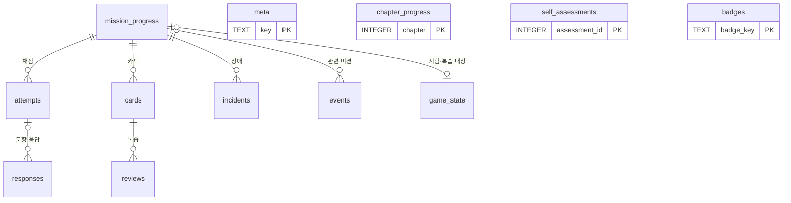

# ERD v1.0 (초안 2026-11-09, 승인 대기)

기준: `docs/PRD.md`(M0-03·M0-08·M0-11~M0-15, M1-05), ADR-0003(SQLite), ADR-0006·0009(콘텐츠는 DB 밖), 2026-11-09 인터뷰 결정(아래 "결정" 절). 정의는 `docs/ddl/v1.0.sql`이다. `docs/ddl/v1.0-checks.sql`의 점검 67개를 `docs/ddl/run_checks.py`로 돌려 Python 3.14.6·SQLite 3.53.1(이 세션, Linux)에서 67개 모두 통과했다(2026-11-09). 일부러 제약 3개를 지운 사본에서는 해당 점검 3개가 정확히 실패해, 점검이 제약을 실제로 잡는 것도 확인했다.

## 관계도

## 표

| 표 | 종류 | 한 행의 뜻 | PRD |
| --- | --- | --- | --- |
| `mission_progress` | 현재 상태 | 학습자가 시작했거나 면제받은 미션 하나 | M0-08, M0-14, M0-15 |
| `game_state` | 현재 상태(한 행) | 시험·복습 모드와 그 대상 미션 | M0-14 |
| `cards` | 현재 상태 | 카드 하나의 Leitner 상자와 만기 | M0-12, M0-13 |
| `chapter_progress` | 현재 상태 | 장 하나의 시작·완료(지연 확인 퀴즈 만기 계산) | M0-12 |
| `incidents` | 현재 상태 | 장애 주입 하나(진행·복구·중단) | M1-05 |
| `meta` | 현재 상태 | 스키마·엔진·콘텐츠 버전 | M1-03 |
| `attempts` | 추가 전용 | `quest check` 한 번 | M0-15, 성공 지표(미션 오판) |
| `responses` | 추가 전용 | 퀴즈·예측·결정·설명 게이트·지연 확인 퀴즈 문항 하나의 정오와 확신도 | M0-11 |
| `reviews` | 추가 전용 | 카드 복습 한 번 | M0-12 |
| `events` | 추가 전용 | 텔레메트리 사건 하나(22종) | M0-15 |
| `self_assessments` | 추가 전용 | 0-9 진단의 장별 이해도(1~3) | IA-10 |
| `badges` | 추가 전용 | 얻은 배지 하나 | design.md 3.6절 |

조회용 뷰 6개: `v_mission_time`(예상 대비 실제 시간), `v_hint_rate`(장별 힌트 사용률), `v_overconfidence`(확신했는데 틀린 비율), `v_mttr`(복구 시간), `v_due_cards`(복습 잠금 판단용 만기 카드 수), `v_delayed_quiz_due`(지연 확인 퀴즈 만기). `quest stats`와 PRD 성공 지표가 이 뷰를 쓴다.

## 도입 단계

| 단계 | 표 |
| --- | --- |
| M0 | `meta`, `game_state`, `mission_progress`, `cards`, `chapter_progress`, `attempts`, `responses`, `reviews`, `events`, `self_assessments`, `badges` |
| M1 | `incidents` |
| M4 | 온콜 주간 표(예정, M4 시작 전에 설계) |

- 학습 상태 DB는 학습자의 맥에서 처음 실행할 때 새로 만든다. v1.0에는 M0·M1 표가 모두 들어 있고, 뒤 단계에서 표가 늘면 `meta.schema_version`을 올리며 마이그레이션으로 더한다(방법은 Spec).

## DB가 직접 막는 것
- 추가 전용 표 6개의 수정·삭제(트리거).
- 미션 키·카드 키의 형식(`m_`·`c_` + 소문자 16진수 8자리). 화면 번호(예: `5-8`)를 키로 쓰는 실수.
- 미션 상태와 완료 시각·완료 방식의 모순(진행 중인데 완료 시각이 있음, 통과인데 완료 방식이 없음, 면제인데 시험 면제가 아님, 면제가 아닌데 시작 시각이 없음).
- 값의 범위: 장 0~17, 힌트 0~3, 상자 1~5, 확신도 1~3, 이해도 1~3, 정해진 상태·모드·종류 값.
- 진행 중인 장애는 하나만(부분 유일 인덱스). 장애 상태와 시각의 모순.
- 게임 상태는 한 행뿐이고, 모드와 대상 미션이 서로 맞아야 한다.
- 시각 형식(UTC ISO-8601), JSON 칸의 형식(체크 결과는 배열, 이벤트 값은 객체), 칸의 타입(STRICT 표).
- 외래 키. 단, SQLite는 연결마다 `PRAGMA foreign_keys = ON`을 켜야 검사한다.

## 결정 (2026-11-09 인터뷰)
1. 저장 방식: 자주 읽는 것은 현재 상태 표에, 시도·응답·복습·이벤트·자기 진단·배지는 추가 전용 기록에 둔다.
2. 미션은 바뀌지 않는 무작위 미션 키로 가리킨다. 화면 번호는 콘텐츠에서만 관리하고, DB에는 기록 당시 사본(`display_id`)만 남긴다.
3. `quest reset`은 DB 파일을 시각이 붙은 백업 파일로 옮긴 뒤 새 DB를 만든다. 새 DB의 첫 이벤트(`reset_backup`)에 백업 파일 이름을 남긴다.

## 이번에 정한 가정 (승인 시 함께 확인)
1. 미션 스키마(design.md 8.3절)에 미션 키 필드가 늘어난다. 카드도 카드 키를 갖는다. 정확한 스키마는 Spec에서 정한다.
2. 키는 한 번 정하면 바꾸지 않고, 지운 미션의 키는 다시 쓰지 않는다. 콘텐츠 테스트가 이전 버전과 비교해 막는다(Spec).
3. DB에는 키·번호·숫자·시각만 저장하고, 콘텐츠 텍스트(요청문·힌트·체크 설명·정답)는 저장하지 않는다. 학습자가 `quest stats`로 SQL을 직접 돌리기 때문이다(design.md 3.8절). 예외는 학습자가 직접 쓴 자기 진단 근거(`self_assessments.reason`)다. DB가 막을 수는 없으므로 엔진 테스트로 확인한다.
4. 체크는 미션 안의 순번(1, 2, …)으로만 기록한다. `quest status --json`의 "남은 체크 ID"도 이 번호다(IA 결정 5).
5. 현재 미션은 저장하지 않고 콘텐츠 순서와 `mission_progress`로 계산한다. "장애 진행 중" 모드도 `incidents`에서 계산한다.
6. 시각은 UTC로 저장하고 화면에는 한국 시간으로 보여 준다.
7. 문법·실행 오류로 채점을 끝내지 못한 시도는 `outcome = 'error'`로 남기고, 실패 수(`fails`)에는 세지 않는다(design.md 3.6절).
8. Leitner 상자 규칙(맞으면 한 칸 위, 틀리면 1번 상자)은 DB가 아니라 엔진이 지킨다. 나중에 FSRS로 바꿀 수 있게 하려는 것이다(design.md 3.7절).
9. 복습 잠금 기준값(기본 20)은 설정 파일에 두고, DB는 만기 카드 수(`v_due_cards`)만 준다.
10. 지연 확인 퀴즈의 만기는 장 완료 14일 뒤로 계산한다.
11. 학습자 이름 같은 개인 정보는 저장하지 않는다.

## 확인하지 못한 것
- 맥에서 uv로 받는 Python 3.14에 들어 있는 SQLite 버전. 이 세션(Linux)의 uv Python 3.14.6은 SQLite 3.53.1이었다. STRICT 표에는 3.37 이상이 필요하므로, 엔진이 시작할 때와 `quest doctor`가 버전을 확인한다(S1 엔진도 SQLite 버전을 검사했다).
- 실제 데이터가 쌓였을 때의 크기와 인덱스 적합성. 아직 데이터가 없다.
- 백업·복원 절차. Spec에서 정하고 M0 게이트에서 확인한다.
