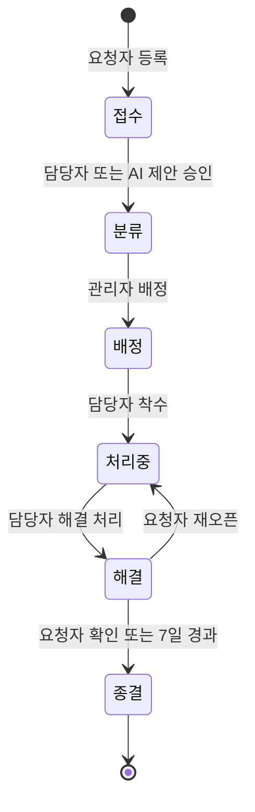
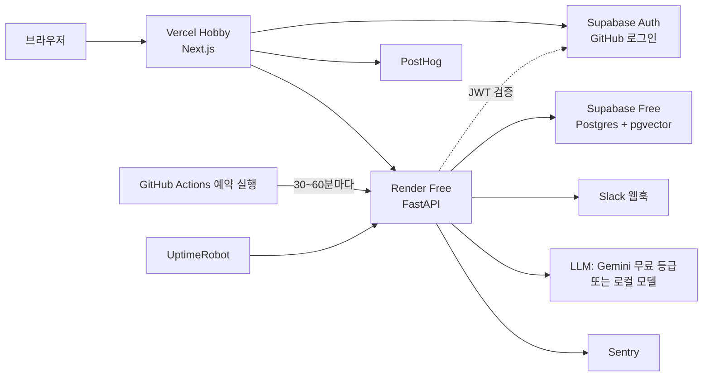

# 🔨 Product Forge With AI
### AI와 함께 만드는 풀사이클 제품 개발 학습 게임 · 설계서 v0.3.5 · 2026-11-09

> 이 문서의 용도: (1) 학습자가 전체 그림을 보는 지도, (2) AI 코딩 도구에 넘겨 게임을 제작하는 명세.
> 표기: ✅ 출처로 확인한 사실 · ⚠️ 출처 간 상충 또는 공식 문서 미확인 · 📐 추정치(실측으로 보정할 값)
> 이력: v0.1~v0.2는 "SAILINGSTONE QUEST S2"(특정 회사 지원 목표)였고 `sikomar00/sailingstone-quest`의 `claude/season2-design` 브랜치에 남아 있다. v0.3에서 목표와 소재를 바꿨고, v0.3.1에서 무료 리소스 검토 결과(인증·도메인·스케줄러·첨부·메일)를, v0.3.2에서 5-14 코어 승격과 Supabase 조직 분리를, v0.3.3에서 용어 정리(GLOSSARY)를, v0.3.4에서 IA 결정(콘텐츠 리포 분리 등)을, v0.3.5에서 UJ·PRD 결정과 9절 바로잡음을 반영했다(부록 A).

---

## 0. 요약

- **목표 수준**: 제품 하나를 기획부터 운영·개선까지 만들면서, 단계마다 "무엇을 왜 하는지, 어떤 도구의 어떤 기능을 왜 쓰는지" 알고 AI에게 지시하고 결과를 검증할 수 있는 수준.
- **소재**
  - 메인: 업무 요청·장애 처리 SaaS **OpsDesk**
  - 마지막 개선 사이클: OpsDesk 안의 **피드백 모듈**
  - 선택 연결 트랙: 이미 진행 중인 **Tech Radar Agent**(6절)
- **형식**: 터미널 게임. 실제 도구를 실제 환경에서 쓰고, 게임은 결과물과 시스템 상태를 검사해 채점한다. S1 게임 엔진(채점·힌트·복습·XP)을 가져와 확장한다.
- **규모** 📐: 18장(0~17장), 미션 207개(코어 177 + ➕선택 30), 코어 약 235시간.
- **일정** 📐
  - 계획: 주 20시간 기준 작업 12주 + 버퍼 2주 = 14주. W1을 2026-11-16로 가정하면 2027-02-21에 끝난다.
  - 보수: S1 진행 속도(계획 대비 50~63%)를 적용하면 21~26주, 2027-04-11~05-16 종료.
  - 1·2장 실측 후 다시 계산한다.
- **예산**: 월 1~3만 원 안. 무료 우선이라 평달 비용은 도메인 비용을 월로 나눈 값뿐이다. 첫해 월 약 300~600원, 2년차부터 월 약 1,200원이고(1달러 1,400원 가정 📐), 많이 드는 달은 1~2만 원이다(7절).
- **최종 산출물**
  - OpsDesk 공개 리포와 라이브 URL(무료 PaaS, 자기 도메인)
  - 운영 대시보드와 제품 지표 대시보드
  - AI 기능 품질 리포트
  - 포스트모템, ADR 모음
  - 개선 사이클 리포트

---

## 1. 설계 근거

### 1.1 결정 기록

| 항목 | 결정 | 근거·반영 |
|---|---|---|
| 목표 | 풀사이클 제품 개발 리터러시(특정 회사와 무관) | 사용자 결정(2026-11-09) |
| 소재 | OpsDesk 메인 + 피드백 모듈, Tech Radar는 선택 | 사용자 결정. 후보 비교는 부록 A.3 |
| 프론트엔드 | Next.js(React + TypeScript)를 리터러시 수준으로 | 사용자 결정 |
| 인증 | Supabase Auth(GitHub 로그인) + FastAPI에서 JWT 검증 | 직접 만든 인증의 위험(OWASP A07)을 피하고, 무료 범위(월 활성 사용자 5만 명) 안이며 가입 메일이 필요 없다. DB와 같은 Supabase 프로젝트를 써서 프로젝트 수가 늘지 않는다(부록 A.5) |
| Supabase 위치 | 기존 계정에 OpsDesk 전용 Free 조직을 새로 만든다 | 사용자 결정(2026-11-09). 결제·전송량은 조직 단위라 Tech Radar와 나뉜다. 무료 프로젝트 2개는 사용자 단위라 Tech Radar 1개 + OpsDesk 1개로 다 찬다(부록 A.6) |
| 저장소 | 게임·설계: `product-forge-with-ai`, 제품: `opsdesk`(2장에서 생성) | 사용자 결정 |
| 사용자 초대 | 불가 | 제품 분석은 도그푸딩 + 합성 트래픽(4.8절) |
| 예산 | 월 1~3만 원, 무료 우선. 무료로 바꿀 때 크게 떨어지는 곳만 유료 | 7절 |
| 시간 | 주 20시간 이상, 마감 없음 | 일정은 1·2장 실측 후 재계산 |
| 환경 | Mac Apple Silicon, RAM 16GB 이상 | 로컬 VM·Docker·k3d 사용 가능 |
| AI 코딩 도구 | Claude Code 기준 + Cursor·Copilot 대응표 | 0장 |

### 1.2 학습자의 현재 상태 (리포에서 확인한 사실)

| 출처 | 확인한 것 | 설계 반영 |
|---|---|---|
| `tech-radar-agent` | 6단계 로드맵 중 3단계 진행. PRD·SPEC·ERD·IA·User Journey·ADR 7개·Plan·Intent 문서. 단계 게이트(정밀도·재현율 목표). 시험 함수 264개(기록상 351개 통과). 마이그레이션 4개. 워커·잡 재시도·하루 호출 상한. 프롬프트 인젝션 고정 시험. 백업·복원 확인 | 기획·설계·AI 평가는 이미 AI와 함께 해 봤다 → 3·4·15장에 배치고사를 두고 "내 산출물 해설"로 이해를 확인한다 |
| `tech-radar-agent` | CI 설정·Dockerfile·배포 설정이 없다. 웹은 127.0.0.1 전용이고 로그인이 없다. 워커는 개인 PC에서 돈다 | 인증·컨테이너·배포·CI/CD·관측은 새로 배운다 → 5·7·9·10·11·14장 비중 유지 |
| `tech-radar-agent` ADR-0006 | 웹은 Starlette 서버 렌더링. Next.js + Supabase 클라이언트는 TypeScript 스택이 하나 더 생기고 RLS·로그인이 필요해서 기각 | 7장 ⚖️ 미션: 같은 사람이 다른 제품에서 다른 선택을 한 이유 |
| `tech-radar-agent` ADR-0004 | LLM은 Gemini 무료 API. 무료 등급은 입력이 구글 제품 개선에 쓰이고 사람이 읽을 수 있다는 점을 확인했고, 공개된 글의 제목·발췌만 보낸다 | OpsDesk도 무료 등급을 쓰되 합성 데이터만 보낸다(7절) |
| `tech-radar-agent` CLAUDE.md | 전역 하네스: 인터뷰 → 문서 순서와 문서별 승인 → Plan → Intent, "알아서 할 일 / 멈춰서 물을 일" 목록, 커밋 type 분리 | 0장에서 이 하네스를 도구 기능 단위로 해설한다. Product Forge 제작도 같은 절차를 쓴다(9절) |
| `tech-radar-agent` PRD | 4단계 전에 "상시 운영·인터넷 배포·로그인"을 정하는 열린 질문이 있다 | 10장 선택 미션이 이 결정에 쓸 자료를 만든다(6절) |
| `sailingstone-quest` | S1 SQL 게임 4장 진행 중. 원격 커밋 2개(최근 메시지 `,`) | SQL은 S1 0~3장 수준이면 5장에 충분하다. 2장에서 커밋 습관 미션 유지 |
| 인터뷰 | 직접 손으로 해 본 것은 Git 브랜치·머지·충돌 | 2장 배치고사. 나머지 장은 0장 진단 결과로 조정 |

### 1.3 "전형적인 루트"에 무엇을 넣었나 (근거 데이터) ✅

- **Stack Overflow 2025 개발자 설문**
  - Docker 사용률 71.1%(전년 대비 +17%p), PostgreSQL이 DB 사용률 1위(55.6%).
  - 웹 프레임워크 사용률: Node.js 약 49%, React 약 45%, Next.js 약 21%(보도 기준).
  - AI 결과를 "매우 신뢰한다"는 응답은 약 3%로 보도됐다. → AI 결과를 검증하는 능력을 목표의 중심에 둔다.
- **GitHub Octoverse 2026**(2026-10-28 발표, 2차 보도 기준)
  - Python은 올해도 2위(1위는 TypeScript).
  - 지난 1년 PR의 40% 이상이 AI 에이전트에서 시작됐다.
  - AI 에이전트 흔적이 있는 2026년 신규 리포는 TypeScript를 주 언어로 쓰는 비중이 35%로, 흔적이 없는 리포(24%)보다 높다.
  - → 백엔드 Python(FastAPI) + 프론트 TypeScript(Next.js) 구성. 단 GitHub 순위는 기여자 활동 지표이고, 코드량·실행량을 잰 것이 아니다.
- **OWASP Top 10:2025**: A01 접근 제어 실패, A02 보안 설정 오류, A03 소프트웨어 공급망 실패(신규). → 보안을 한 장에 몰지 않고 장마다 해당 항목을 연결한다.

### 1.4 학습 설계 근거

- **인출 연습·분산 학습**: Dunlosky et al.(2013)은 10개 학습 기법 중 practice testing과 distributed practice만 "high utility"로 평가했다. → 매일 복습, 예측·드릴 미션.
- **시험 효과**: Roediger & Karpicke(2006). → 장마다 퀴즈와 승급 시험.
- **풀이 예시 효과**: 초보자는 바로 문제를 푸는 것보다 풀이 예시를 먼저 볼 때 인지 부하가 낮다(Sweller & Cooper 1985). 익숙해지면 예시를 점진적으로 걷어낸다(Renkl & Atkinson 2003). → 스캐폴딩 3단계.
- **교차 연습·자기 설명**: Dunlosky et al.(2013)은 interleaved practice와 self-explanation을 "moderate utility"로 평가했다. → 🔁 연결 미션, 설명 게이트.
- **AI 보조와 숙련 형성** ✅: Anthropic 무작위 대조 실험(2026-01-29, 약 52명)
  - AI 사용 그룹의 퀴즈 평균은 50%, 직접 코딩한 그룹은 67%였다. 작업 시간 차이는 유의하지 않았다.
  - 격차가 가장 큰 영역은 디버깅이었다.
  - 개념 질문 위주로 AI를 쓴 패턴은 65~86%, 코드 생성·디버깅을 맡긴 패턴은 24~39%였다.
  - → 디버깅(장애) 미션은 AI 금지, 개념 질문은 허용, 위임은 "손으로 한 번 해 본 뒤에만".
- **체감과 실측의 차이** ✅: METR 무작위 대조 실험(2025-07, 숙련 개발자 16명, 실제 과제 246개)
  - AI를 허용한 과제가 19% 더 오래 걸렸다.
  - 참가자들은 사전에 24% 단축을 예상했고, 끝난 뒤에도 20% 빨라졌다고 믿었다.
  - → 시간 계측과 확신도 평정을 넣는다.

---

## 2. 목표 수준과 졸업 기준

### 2.1 리터러시의 정의: 단계마다 4가지

| 능력 | 내용 | 확인 방법 |
|---|---|---|
| 설명 | 이 단계의 목적, 대표 도구, 각 도구의 핵심 기능 5개를 말할 수 있다 | 🧠 퀴즈, 🗺️ 도구 지도 카드 복습 |
| 결정 | 상황에 맞는 도구·기능을 근거와 함께 고른다 | ⚖️ 결정 미션, ADR |
| 검증 | AI가 만든 결과를 체크리스트로 검토하고 고친다 | 🔍 감사 미션, 설명 게이트 |
| 진단 | 흔한 장애의 원인을 찾아 복구한다 | 🚨 장애 미션(AI 금지) |

### 2.2 졸업 기준 (전부 게임이 자동 검사)

| 영역 | 졸업 기준 |
|---|---|
| AI 협업 | AI 튜터 모드 설정. 스펙을 먼저 쓰고 AI에 맡긴 구현이 계약 테스트 통과. 위임 미션의 설명 게이트 통과 |
| 기획 | PRD(범위·비범위·성공 지표), 수용 기준이 있는 유저 스토리, 백로그 |
| 설계 | C4 다이어그램, ERD, 상태 전이 표, 권한 매트릭스, OpenAPI, ADR 5건 이상 |
| 백엔드 | 관리형 인증(Supabase Auth) 연동과 JWT 검증, 역할별 접근 제어(다른 사람 티켓 접근 차단), 서버가 강제하는 상태 전이, 추가 전용 감사 로그 |
| 비동기 | SLA 위반 감지와 알림이 재시도·중복 방지와 함께 동작 |
| 프론트엔드 | 요청자·담당자·관리자 3가지 흐름이 화면에서 끝까지 동작, 접근성 기본 점검 통과 |
| 테스트 | 권한 매트릭스 테스트, E2E 1개 이상, 변이 테스트 점수 기록 |
| Git·CI/CD | 보호된 main, PR마다 검증, 머지 시 자동 배포, 액션 SHA 고정 |
| 배포 | 라이브 URL(HTTPS, 자기 도메인), 환경 분리, 롤백 경험 |
| 운영 | 에러 추적, 업타임 감시, 백업 복구 드릴, 포스트모템 |
| 보안 | OWASP Top 10:2025 체크리스트 감사 통과 |
| 제품 안의 AI | 분류 정밀도·재현율과 사람 수정률 리포트, 프롬프트 인젝션 차단, 모델 비교표 |
| 분석·개선 | 트래킹 플랜, 퍼널, 피처 플래그 출시, 피드백 → 개선 → 효과 측정 리포트(합성 데이터 표시) |

---

## 3. 게임 디자인

### 3.1 세계관

학습자는 가상 회사 **포지랩(Forge Lab, 직원 50명)** 의 1인 개발자다. 사내 요청(장비·계정·장애)이 메신저와 메일로 흩어져 처리가 자주 누락된다는 문제에서 출발한다. OpsDesk를 만들어 사내에 도입하고, 마지막에는 피드백으로 제품을 개선한다.

| 인물 | 역할 | 주로 등장하는 장 |
|---|---|---|
| 서하린 | PM. 요구사항과 우선순위 | 3, 15, 16, 17 |
| 문도윤 | 테크 리드. 설계와 코드 리뷰(리뷰봇 이름) | 0, 2, 4, 5, 7, 8 |
| 이세아 | 디자이너. UX와 와이어프레임 | 4, 7 |
| 백준호 | SRE·보안. 서버·배포·운영·장애 | 1, 6, 9~14, 17 |
| 포지랩 직원 50명 | 요청자(합성 사용자) | 6, 16 |
| 🚨 온콜봇 | 장애 알림 | 장애 미션 |

등급: 견습(0~4장) → 주니어(5~8장) → 미들(9~13장) → 시니어 후보(14~17장).

### 3.2 핵심 루프

```
미션 수신(요청문) → 카드(개념·용법·도메인·도구 지도) → 실제 작업 → quest check
   → 체크리스트 피드백(✅/❌ + 흔한 실수 감지) → 통과 시 보상 + 설명 게이트
   → 카드가 복습 덱에 추가 → 다음 미션
```

- `quest goals`: 2.2절 졸업 기준 13개 영역의 현재 충족 상태를 첫날부터 보여 준다. 목적지가 보이게 하는 장치다.
- `quest status --json`: 현재 미션 ID, AI 태그, 남은 체크의 ID와 개수를 출력한다. 체크 설명·힌트·정답은 넣지 않는다(IA 결정 5). AI 튜터 모드(3.5절)가 이 값을 읽는다.
- 전체 명령 구조(IA-1~IA-19)는 `docs/IA.md`에 있다.

### 3.3 카드: 미션마다 붙는 학습 단위

| 카드 | 내용 |
|---|---|
| 🧩 개념 | 왜 그렇게 동작하는가 |
| 🔧 용법 | 명령, 문법, 설정 |
| 🏭 도메인 | 실무 맥락, 업계 관행, 수치 |
| 🗺️ 도구 지도 | 새 도구를 처음 쓰는 미션에 붙는다. 아래 양식 |

🗺️ 도구 지도 양식(예: Docker):

```
도구: Docker
무엇: 앱과 실행 환경을 이미지로 묶어 어디서나 똑같이 실행
왜: "내 PC에선 되는데" 문제를 없애고, 배포 단위를 하나로 통일
안 써도 될 때: 정적 사이트를 PaaS에 올릴 때(플랫폼이 대신 빌드)
핵심 기능 5: Dockerfile · 멀티스테이지 · 볼륨 · 포트 매핑 · Compose
대안: Podman, PaaS의 자동 빌드
AI에게 시킬 때: "non-root, 멀티스테이지, .dockerignore 포함"을 조건으로 명시
검증 체크: 이미지 크기, USER, 헬스체크, 캐시 순서, 시크릿 포함 여부
```

복습 덱은 네 종류 카드를 섞어서 출제한다. 도구 지도 카드는 "핵심 기능 5개 말하기"와 "이 상황에 이 도구가 맞나" 문제로 나온다.

### 3.4 미션 유형

| 유형 | 표시 | 채점 | AI |
|---|---|---|---|
| 실습 | 🎫 | 상태 검사 체크리스트(파일, Git, HTTP, DB, 컨테이너, 클러스터, 외부 서비스) | 🤝 기본 |
| 개념 퀴즈 | 🧠 | 객관식·단답·순서 맞추기 | 🔒 |
| 예측 | 🔮 | 실행 전에 결과를 예측해 입력 → 실행 → 비교·해설 | 🔒 |
| 드릴 | ⌨️ | 명령 회상(정규식으로 허용 답 매칭), 매일 복습에 출제 | 🔒 |
| 결정 | ⚖️ | 시나리오에서 도구·구조를 고르고 근거 항목을 체크. 기준표로 채점 | 🤝 |
| AI 산출물 감사 | 🔍 | 결함을 심어 둔 AI 산출물(문서·코드·설정)에서 결함을 찾아 고치고 이유를 답한다 | 🤝 |
| 장애 | 🚨 | 게임이 장애를 주입 → 복구 상태 검사 + 근본 원인 퀴즈 + 복구 시간(MTTR) 측정 | 🔒 |
| 승급 시험·보스 | 🏁 | 그 장 산출물 체크 전체를 포함하는 상위 집합 | 🔒/🤝 |
| 복습 | 📅 | 만기 카드 + 예전 미션을 빈 샌드박스에서 다시 만들기 | 🔒 |

표시 규칙:
- ➕ 선택 미션(표시가 없으면 코어). 코어만으로 졸업 기준을 충족하도록 설계한다.
- 🔁 연결 미션: 앞 장 기술을 다시 쓴다.
- `-TR`로 끝나는 ID: Tech Radar 연결 트랙(전부 선택, 6절).
- (중간 점검): 20시간이 넘는 장에 지정하는 미니보스. 기존 미션에 표시만 한다.
- 스캐폴딩 3단계: 새 도구의 첫 미션은 `worked`(풀이 예시 따라 하기), 다음은 `completion`(빈칸 채우기), 그다음부터 `independent`(독립 과제).
- 보스의 체크는 그 장 모든 산출물 체크의 상위 집합이다. 승급 시험으로 남은 미션을 면제받아도 다음 장에 필요한 산출물은 반드시 있다.

### 3.5 AI 사용 정책

| 태그 | 의미 | 적용 |
|---|---|---|
| 🔒 solo | AI 사용 금지 | 퀴즈, 예측, 드릴, 장애, 시험 |
| 🤝 pair | 개념 질문과 리뷰는 허용. 코드는 학습자가 먼저 쓴다 | 대부분의 실습, 결정, 감사 |
| 🚀 delegate | AI가 생성해도 된다. 대신 설명 게이트와 검증 수단을 통과해야 한다 | 같은 기술을 손으로 한 번 이상 해 본 뒤의 미션 |

- **설명 게이트**: 🤝·🚀 미션을 통과하면 내 산출물에 대한 질문 2~3개에 답한다. 질문은 미리 작성해 두고 결정적으로 채점한다.
- **위임의 검증 수단**: 계약 테스트, 변이 테스트(mutmut), CI, 설명 게이트. 하나라도 통과하지 못하면 미션 실패다.
- **강제 수단은 없다(자율 준수).** 대신 제품 리포의 CLAUDE.md에 학습 모드를 넣어 AI가 미션 태그에 맞게 행동하게 한다. 사용자의 기존 하네스(CLAUDE.md 전역 규칙)에 아래 절을 추가하는 방식이다.

```markdown
## 학습 모드 (Product Forge)
- 작업 전에 `quest status --json`으로 현재 미션 ID와 AI 태그를 확인한다.
- 🔒 solo: 정답 코드·명령을 주지 않는다. 개념 설명과 되묻기만 한다.
- 🤝 pair: 개념 질문과 리뷰는 자유. 코드는 학습자가 먼저 쓴다.
- 🚀 delegate: 생성해도 된다. 바꾼 이유를 줄 단위로 설명하고 검증 체크리스트를 함께 낸다.
- 새 도구를 쓰면 먼저 "무엇·왜·핵심 기능·대안·검증 방법"을 설명한다.
```

- AI가 내장된 터미널을 쓴다면 🔒 미션 동안에는 AI 기능을 끈다.

### 3.6 보상

- **S1에서 그대로**: 원샷 +20%, 힌트 1개당 -20%(최대 -60%), 모범 답안을 보면 보상 20% + 복습 목록 추가, 승급 시험으로 남은 미션 면제(각 50%), 문법·실행 오류는 오답으로 세지 않음.
- **추가**
  - 장애: 목표 MTTR 안에 복구하면 +30%. 장애 중에는 힌트 비용이 2배.
  - 예측: 예측이 맞으면 +10%.
  - 설명 게이트를 통과해야 XP가 확정된다.
  - 연속 복습 일수는 주 1회 휴식권을 쓰면 끊기지 않는다.
- **배지**: 🟢 첫 그린 CI · 🔐 권한 지킴이(IDOR 장애 복구) · 🧭 상태 기계 · 🐳 원커맨드 · 🚀 첫 배포 · 🧪 변이 생존자 0 · 🚒 인시던트 커맨더(목표 MTTR 5회) · 🤖 HITL 설계자 · 📈 퍼널 분석가 · 🔁 개선 사이클 완주 · 📅 꾸준함(14일).

### 3.7 복습과 측정

- 카드는 처음에 Leitner 5단계 상자로 시작하고, 데이터가 쌓이면 FSRS로 교체를 검토한다.
- `quest review`: 만기 카드 10~15장, 약 15분 📐.
- 복습 잠금: 만기 카드가 20장 📐 이상이면 새 미션이 열리지 않는다. 진행 중인 미션, 장애 복구, 복습은 막지 않는다(UJ 결정 3).
- 주 1회 재구성 복습: 예전 미션을 빈 샌드박스에서 다시 만든다.
- 지연 확인 퀴즈: 장을 마치고 2주 뒤 그 장의 핵심 10문항을 다시 푼다. 진행률이 아니라 기억 유지율을 재는 지표다.
- 확신도 평정: 퀴즈·예측의 답과 함께 확신도(1~3)를 입력한다. `quest stats`가 "확신했는데 틀린 비율"을 보여 준다.
- 온콜 주간(선택, 12장 이후): `quest oncall start`를 켜 두면 일주일 동안 무작위 시각에 이미 클리어한 장애가 재발한다.

### 3.8 계측과 일정 보정

- 미션마다 시작 시각, 첫 check, 완료 시각, 실패 횟수, 힌트 수, AI 태그를 SQLite에 기록한다. `quest stats`로 SQL 조회가 된다.
- **1장과 2장이 끝나면 전체 일정을 실측치로 다시 계산한다.** 이 문서의 시간은 모두 📐 추정치다.
- 보정 근거: S1은 계획 대비 50~63%만 진행됐다(관측 1개, 시간 조건이 다름 → 상한 참고값). v0.2 설계서는 시간 합계를 잘못 적었다가 고친 적이 있다(310h → 294h). 추정치는 검산하고 실측으로 바꾼다.

### 3.9 플레이 화면 예시

```
$ quest
  🔨 PRODUCT FORGE WITH AI     주니어 · 2,140 XP · 📅 복습 6일 연속
  📈 5장 백엔드 ▓▓▓▓▓▓░░░░░░░░░ 8/17      오늘 복습 카드 11장 (quest review)
  ▶ 현재 미션 5-8 인가: 요청자는 자기 티켓만   🤝 pair · 예상 60분

$ quest check
  채점 중… [5-8]
   ✅ GET /tickets 는 요청자 본인 티켓만 반환
   ❌ GET /tickets/{다른 사람 ID} → 404 또는 403 이어야 함   (현재 200)
   ✅ 담당자는 배정된 티켓 조회 가능
   ❌ 관리자만 담당자 변경 가능                              (요청자 토큰으로 200)
  💡 흔한 실수: 목록에는 필터를 걸었지만 상세 조회는 ID만 보고 반환하고 있어요(IDOR).
```

---

## 4. 소재 프로젝트: OpsDesk

### 4.1 무엇을 만드나

직원이 요청을 등록하면 담당자가 배정받아 처리하고, 요청자가 해결을 확인하면 종결되는 서비스다. 웹 제품의 핵심 문제가 거의 모두 등장한다.
- 권한: 요청자·담당자·관리자 분리
- 상태 전이: 서버가 허용된 전이만 받기
- 이력: 감사 로그
- 시간 기반 처리: SLA
- 알림: 실패와 재시도
- AI 보조: 잘못 분류하면 사람이 수정
- 운영 지표: 서비스가 나아지는지 측정

### 4.2 MVP 범위

- **포함**
  - 역할 3개: 요청자, 담당자, 관리자
  - 상태 6개: 접수 → 분류 → 배정 → 처리 중 → 해결 → 종결, 재오픈 가능
  - 우선순위별 SLA 2종: 첫 응답 시간, 해결 시간
  - 인증: Supabase Auth(GitHub 로그인). 앱 역할(요청자·담당자·관리자)은 OpsDesk DB에서 관리
  - 알림: 앱 내 알림 + Slack 웹훅. 메일은 개발 단계에서 Mailpit
  - 감사 로그: 추가만 가능, 수정·삭제 불가
  - 운영 대시보드 KPI 3개: 미처리 건수, SLA 위반율, 평균 해결 시간
  - AI 기능 3개: 자동 분류, 긴 대화 요약, 유사 티켓 검색
  - 피드백 모듈: 마지막 개선 사이클용(4.9절)
- **선택 미션으로 미룸**: 운영 메일 발송(6-8), 첨부 이미지(7-12), 이메일 수신 파싱, 영업시간 달력, 멀티테넌트, 매크로, 만족도 조사

### 4.3 도메인 지식 (IT 서비스 관리 기본)

- **요청의 종류**: 장애(incident, 서비스가 멈추거나 느려짐), 서비스 요청(계정·장비 등 정해진 요청), 문제(problem, 반복 장애의 근본 원인), 변경(change, 시스템 변경 승인).
- **우선순위**: 영향도 × 긴급도 매트릭스로 정한다(예: 영향 큼 × 긴급 높음 = P1).
- **SLA**: 우선순위마다 첫 응답과 해결 목표 시간을 정하고, 넘기면 위반이다. 위반 직전 경고와 에스컬레이션이 흔한 장치다.
- 이 개념은 3장(기획)과 4장(설계)의 도메인 카드로 나온다.

### 4.4 데이터 모델 초안

| 테이블 | 주요 컬럼 | 비고 |
|---|---|---|
| users | id(= Supabase Auth 사용자 ID), email, name, role | 로그인은 Supabase Auth가 맡고, 역할(requester·agent·admin)은 여기서 관리 |
| tickets | id, requester_id, assignee_id, type, category, priority, status, title, created_at | 상태는 서버가 전이 규칙으로만 바꾼다 |
| ticket_events | id, ticket_id, actor_id, kind, from_status, to_status, payload, created_at | 추가 전용(감사 로그) |
| comments | id, ticket_id, author_id, body, internal, created_at | internal = 담당자끼리만 보는 메모 |
| sla_policies | priority, first_response_min, resolution_min | |
| sla_timers | ticket_id, kind, due_at, breached_at | 6장 작업이 갱신 |
| notifications | id, user_id, ticket_id, channel, status, attempts, dedupe_key | dedupe_key로 중복 발송 방지 |
| ai_suggestions | id, ticket_id, kind, value, confidence, model, accepted, corrected_value | 사람 수정률 계산용 |
| ticket_embeddings | ticket_id, embedding | 15장 유사 검색(pgvector) |
| attachments(➕) | id, ticket_id, object_path, size_bytes, content_type | 7-12. URL이 아니라 비공개 버킷 안의 경로만 저장 |
| feedback_items·votes·roadmap_items·changelog | — | 16·17장 피드백 모듈 |

### 4.5 상태 전이



허용되지 않은 전이를 요청하면 서버는 409를 돌려준다(5-9). 모든 전이는 `ticket_events`에 남는다(5-10).

### 4.6 권한 매트릭스 초안

| 행동 | 요청자 | 담당자 | 관리자 |
|---|---|---|---|
| 티켓 등록 | ✅ | ✅ | ✅ |
| 티켓 조회 | 본인 것만 | 배정된 것·팀 큐 | 전체 |
| 내부 메모 보기 | ❌ | ✅ | ✅ |
| 담당자 배정 | ❌ | ❌ | ✅ |
| 상태 변경 | 재오픈·확인만 | 착수·해결 | 전체 |
| SLA 정책 수정 | ❌ | ❌ | ✅ |
| 감사 로그 보기 | 본인 티켓 이력 | 배정된 티켓 이력 | 전체 |

8-3에서 이 표를 그대로 테스트로 만든다(역할 × 엔드포인트 → 기대 상태 코드).

### 4.7 AI 기능

| 기능 | 내용 | 평가 지표 |
|---|---|---|
| 자동 분류 | 카테고리·우선순위 제안 + 신뢰도. 사람이 승인하거나 고친다 | 정밀도·재현율·혼동 행렬, 사람 수정률 |
| 요약 | 긴 대화 스레드를 담당자용으로 요약 | 사람 평가 체크리스트(누락·왜곡) |
| 유사 티켓 검색 | 임베딩 + pgvector로 과거 해결 티켓 찾기 | 상위 5개 안에 정답이 들어가는 비율 |
| 답변 초안(➕) | 해결 방법 초안을 만들고 사람이 승인한 뒤 발송 | 승인률, 수정량 |

- 평가셋은 라벨을 붙인 합성 티켓 100건이다. 튜닝용과 보류용으로 나눈다(Tech Radar의 골든셋 방식과 같음).
- 외부 입력(티켓 본문)은 신뢰할 수 없는 데이터로 다룬다. 모델에 도구 권한을 주지 않고, 출력은 JSON 스키마로 검증한다(15-8).

### 4.8 제품 분석 계획 (사용자 초대 불가 조건)

- **도그푸딩**: OpsDesk v0.1을 배포한 직후(10-9)부터 Product Forge 진행 중 생기는 작업·막힘·장애를 OpsDesk 티켓으로 관리한다. 학습자가 실제 요청자이자 담당자가 된다.
- **합성 트래픽**: 시뮬레이터가 가상 직원 50명의 요청 패턴(업무 시간대 몰림, 월요일 급증, 일부 재오픈)을 만든다(16-4). 합성 이벤트에는 `synthetic=true` 속성을 붙인다.
- **한계(문서에 명시)**: 합성 데이터로는 실제 사용자 행동을 검증할 수 없다. 퍼널·리텐션 분석은 "분석 방법과 도구 사용법"을 익히는 용도이고, 결론은 실사용 데이터(n=1)와 구분해 적는다.

### 4.9 피드백 모듈 (마지막 개선 사이클)

- 기능: 피드백 제출 → 투표 → AI 중복 병합 → 로드맵(검토 중·계획·진행 중·출시) → 체인지로그 → 투표자에게 출시 알림.
- 사이클(17장): 피드백 하나를 골라 문제 정의 → 설계 → AI와 구현 → 피처 플래그로 출시 → 지표로 효과 측정 → 회고.

### 4.10 무료 인프라 구성



- Render 무료 웹 서비스는 15분간 요청이 없으면 슬립하고, 백그라운드 워커·크론에는 무료 인스턴스가 없다 ✅. 그래서 SLA 점검은 GitHub Actions 예약 실행이 보호된 엔드포인트를 호출하는 방식으로 한다(6-5에서 다른 방식과 비교).
- 호출 간격 📐: 5분마다 깨우면 서비스가 사실상 잠들지 않아 월 750 무료 시간을 거의 다 쓴다. 30분 간격이면 월 약 370시간, 60분 간격이면 월 약 190시간이다. 감지 지연과 무료 시간 사이의 트레이드오프다.
- 깨어나는 데 최대 약 1분이 걸린다 ✅. 예약 호출은 넉넉한 시간 제한과 재시도를 둔다.
- Vercel Cron은 Hobby에서 하루 1회만 돌아서 SLA 점검에 쓸 수 없다 ✅. Cron Jobs를 대체하는 Vercel Schedules는 Hobby에서 최소 15분 간격이라는 검색 요약이 있다 ⚠️(공식 문서 원문 미확인). 6-5에서 GitHub Actions 예약 실행·Supabase Cron과 비교한다.
- 사람 사용자의 로그인은 Supabase Auth의 GitHub 로그인만 쓴다. 가입 확인 메일이 필요 없어서 기본 메일 제약(프로젝트 팀원 주소에만, 시간당 2통)을 피한다 ✅.
- 역할별 테스트 계정(채점·E2E용 3개)과 16-4의 가상 직원 계정은 메일을 보내지 않고 대시보드나 관리 API로 만든 뒤 비밀번호 로그인으로 토큰을 받는다. 정확한 설정은 구현 시 확인한다 ⚠️(12절).

---

## 5. 커리큘럼

### 5.1 로드맵

0~2장은 전 과정에서 계속 쓰는 기반 도구라 앞에 둔다. 3장부터는 실제 제품 개발 순서를 따른다. 배포(10장)를 먼저 손으로 해 보고, 그다음 자동화(11장)를 배운다.

```mermaid
flowchart LR
  C0["0 작업장"] --> C1["1 터미널·Linux"] --> C2["2 Git·GitHub"] --> C3["3 기획"] --> C4["4 설계"]
  C4 --> C5["5 백엔드"] --> C6["6 비동기·외부 연동"] --> C7["7 프론트엔드"] --> C8["8 테스트·품질"]
  C8 --> C9["9 컨테이너"] --> C10["10 배포 v0.1"] --> C11["11 CI/CD"] --> C12["12 쿠버네티스 비교"] --> C13["13 클라우드·IaC"]
  C13 --> C14["14 운영·관측"] --> C15["15 제품 안의 AI"] --> C16["16 분석·개선·런칭 v1.0"] --> C17["17 Forge Run"]
```



| 장 | 주차 📐 | 핵심 질문 | 대표 도구(대안) | OpsDesk 산출물 | 코어 시간 📐 |
|---|---|---|---|---|---|
| 0 작업장 | W1 | AI 코딩 도구는 어떻게 동작하나 | Homebrew, zsh, Claude Code(Cursor·Copilot), CLAUDE.md/AGENTS.md, MCP | 개발 환경, AI 튜터 모드 | 6h |
| 1 터미널·Linux | W1 | 서버와 도구는 어떻게 움직이나 | bash, SSH, systemd(로컬 VM) | 서버 점검 스크립트 | 12h |
| 2 Git·GitHub | W1~2 | 변경을 어떻게 안전하게 쌓고 합치나 | Git, GitHub(PR·ruleset·Projects), gh | `opsdesk` 리포 | 11h |
| 3 기획 | W2 | 무엇을, 누구를 위해, 어디까지 만드나 | PRD, 유저 스토리, GitHub Projects | PRD·백로그 | 8h |
| 4 설계 | W2~3 | 어떤 구조로 만드나 | Mermaid, ERD, OpenAPI, Figma(AI UI 생성) | 다이어그램·ERD·권한 매트릭스·ADR | 12h |
| 5 백엔드 | W3~4 | 데이터와 규칙은 어디서 처리하나 | FastAPI, Pydantic, PostgreSQL, SQLAlchemy·Alembic, Supabase Auth, Postman(Bruno) | API v0.1 | 28h |
| 6 비동기·외부 연동 | W4~5 | 시간 기반 작업과 알림은 어떻게 돌리나 | GitHub Actions 예약, Supabase Cron, Mailpit, 웹훅 | SLA·알림 파이프라인 | 8h |
| 7 프론트엔드 | W5~6 | 사용자는 무엇을 보고 누르나 | Next.js, React, TypeScript, Tailwind·shadcn/ui | 웹 v0.1 | 19h |
| 8 테스트·품질 | W6 | 동작을 어떻게 증명하나 | pytest, Playwright, Newman, ruff·tsc, mutmut | 품질 게이트 | 14h |
| 9 컨테이너 | W6~7 | 실행 환경을 어떻게 똑같이 맞추나 | Docker, Compose, Trivy | 원커맨드 개발 환경 | 12h |
| 10 배포·인프라 선택 | W7~8 | 어디에, 왜 올리나 | Vercel, Render, Supabase, DNS·TLS | **🎯 v0.1 공개** | 12h |
| 🛟 버퍼 1 | W8~9 | 밀린 미션·복습·일정 흡수 | — | — | — |
| 11 CI/CD | W9 | 검증과 배포를 어떻게 자동화하나 | GitHub Actions, 프리뷰 배포, Dependabot | PR 검증 + 자동 배포 | 13h |
| 12 쿠버네티스 비교 | W9~10 | 언제 필요하고 언제 과한가 | k3d, kubectl, Helm | K8s 필요성 판단 리포트 | 12h |
| 13 클라우드·IaC | W10 | 인프라를 코드로 관리하면 무엇이 좋은가 | Terraform(GitHub·Cloudflare provider), AWS(선택) | 리포 설정·DNS 코드화 | 10h |
| 14 운영·관측 | W10~11 | 사용자보다 먼저 문제를 알려면 | Sentry, UptimeRobot, 구조화 로그 | 운영 대시보드·포스트모템 | 12h |
| 15 제품 안의 AI | W11~12 | AI 기능의 품질과 비용을 어떻게 관리하나 | LLM API, pgvector, 로컬 모델 | AI 품질 리포트 | 15h |
| 🛟 버퍼 2 | W12~13 | 〃 | — | — | — |
| 16 분석·개선·런칭 | W13 | 만든 게 쓸모 있는지 어떻게 아나 | PostHog, 피처 플래그, 피드백 모듈 | **🎯 v1.0** | 14h |
| 17 Forge Run | W13~14 | 새 기능 하나를 AI와 처음부터 끝까지 | 전 단계 통합 | 개선 사이클 리포트·졸업 | 17h |

- 코어 합계 235시간 📐. 마일스톤 예상: v0.1은 W8(2027-01-04 주), v1.0은 W13(2027-02-08 주), 졸업은 W14(2027-02-21).
- 처음 요청한 도구는 모두 포함된다: 터미널·Linux(1장), GitHub(2·11장), FastAPI(5장), Postman(5·8장), Docker(9장), GitHub Actions(6·11장), 쿠버네티스(12장).
- 보안은 장마다 OWASP 항목으로 연결하고(각 장 "보안" 줄), 17장에서 전체를 점검한다.
- 배치고사(3-0, 4-0, 15-0)를 통과하면 그 장의 기본 미션을 건너뛰므로 실제 시간은 줄어들 수 있다.

---

### 0장. 작업장: 개발 환경과 AI 코딩 도구 — 문도윤 · 📐6h · 🎯 개발 환경, `quest doctor` 통과, AI 튜터 모드

- **핵심 질문**: AI 코딩 도구는 어떻게 동작하고, 무엇을 맡기고 무엇을 막아야 하나?
- **개념**: 패키지 매니저, PATH와 셸 설정 파일, 재현 가능한 환경(Brewfile), 공개키 인증, 맥의 컨테이너는 Linux VM 위에서 돈다, AI 코딩 에이전트의 구조(모델 + 도구 호출 + 컨텍스트 + 권한), 컨텍스트 창의 한계, 규칙 파일, 플랜 모드, MCP(외부 도구를 연결하는 표준)
- **🗺️ 도구 지도**
  - Homebrew: Brewfile, `brew bundle`, cask. 같은 환경을 명령 한 번으로 재현한다.
  - Claude Code(대안: Cursor, GitHub Copilot)
    - 핵심 기능: 규칙 파일(CLAUDE.md / `.cursor/rules` / `.github/copilot-instructions.md`·AGENTS.md), 플랜 모드, 권한·승인, 스킬·서브에이전트, MCP 연결
    - 왜: 지시를 기억시키고, 위험한 행동 앞에서 멈추게 한다.
- **미션**
  - 0-1 🎫 장비 점검(`quest doctor`)
  - 0-2 🎫 Brewfile로 일괄 설치
  - 0-3 🎫 셸·PATH·alias
  - 0-4 🎫 SSH 키로 GitHub 인증
  - 0-5 🧠 AI 코딩 에이전트의 구조(모델·도구·컨텍스트·권한)
  - 0-6 🔮 컨텍스트 창: 큰 리포를 통째로 주면 어떻게 될까
  - 0-7 🎫 AI 튜터 모드 설정(3.5절의 학습 모드 절)
  - 0-8 ⚖️ 도구 대응표: 같은 기능이 Claude Code·Cursor·Copilot에서 어떻게 불리나
  - 0-9 🎫 현재 수준 진단: 18개 단계마다 이해도(1~3)와 근거 → `quest goals` 초기값
  - 0-TR ➕🔍 내 하네스 해설: Tech Radar CLAUDE.md의 규칙이 각각 어떤 도구 기능(규칙 파일·질문 도구·플랜 모드·권한)으로 동작하나

### 1장. 터미널·Linux — 백준호 · 📐12h · 🎯 서버 점검 스크립트

- **랩**: Ubuntu 24.04 VM(기본 OrbStack Linux machine, 대안 Lima·Multipass). 게임은 SSH로 접속해 검사하고, cloud-init으로 로그·사용자·문제 상황을 미리 심어 둔다. 맥 터미널의 BSD 도구와 Linux의 GNU 도구는 옵션이 달라서 Linux 실습은 VM에서만 한다.
- **핵심 질문**: 서버와 개발 도구는 어떻게 움직이나?
- **개념**: 파일시스템 구조(FHS), 권한과 소유자, 사용자와 sudo, 프로세스와 시그널, 표준 입출력·파이프·리다이렉션, 종료 코드, 환경변수(앱 설정의 기초), 셸 스크립트, cron·systemd 기초, SSH
- **🗺️ 도구 지도**
  - bash/zsh: 파이프, 리다이렉션, 종료 코드, 환경변수, 스크립트
  - SSH: 키, config, 포트 포워딩
  - systemd: 서비스, 재시작 정책, journalctl
- **미션**
  - 1-1 🎫 VM 만들고 SSH 접속
  - 1-2 🧠 파일시스템 지도
  - 1-3 🎫 권한·소유자(실행되지 않는 스크립트)
  - 1-4 🔮 경보 TOP 3 파이프라인(`sort | uniq -c | sort -nr`)
  - 1-5 🎫 프로세스·시그널(폭주 프로세스 정상 종료)
  - 1-6 🎫 환경변수와 PATH(앱 설정은 어디서 오나)
  - 1-7 🎫 셸 스크립트(`set -euo pipefail`, 종료 코드)
  - 1-8 🎫 cron·systemd로 상시 실행 (중간 점검)
  - 1-9 ➕🎫 SSH config와 포트 포워딩
  - 1-I1 🚨 디스크 100%(로그 폭주)
  - 1-B 🏁 서버 점검 스크립트 → JSON 리포트 → 주기 실행
  - 1-TR ➕🔍 Tech Radar 워커는 지금 어떻게 돌고 있나(`logs/worker.pid`, ps·tail로 확인)
- **사이드 퀘스트(➕)**: OverTheWire Bandit 0→15, SadServers 입문 시나리오, explainshell.com

### 2장. Git·GitHub 협업 — 문도윤 + 리뷰봇 · 📐11h · 🎯 `opsdesk` 공개 리포

- **배치고사 2-0**을 통과하면 2-1·2-3이 면제된다.
- **핵심 질문**: 변경을 어떻게 안전하게 쌓고 합치나?
- **개념**: 스냅샷과 커밋 그래프, HEAD와 refs, 스테이징, merge와 rebase, 원격 추적 브랜치, reflog, 태그와 SemVer, PR·리뷰·rulesets, Issues·Projects, GitHub Flow, Conventional Commits
- **🗺️ 도구 지도**
  - Git: 커밋 그래프, 브랜치, rebase, reflog, 태그
  - GitHub: PR, 리뷰, rulesets, Issues·Projects, secret scanning
  - gh CLI: 터미널에서 PR·이슈·실행 결과 다루기
- **보안**: 시크릿 유출 방지(secret scanning·push protection, gitleaks). 유출 시 1순위는 키 폐기다.
- **AI 포인트**: AI가 쓴 커밋 메시지와 PR 설명이 "무엇을, 왜"를 정확히 담았는지 확인한다.
- **리뷰봇**: 게임이 제품 리포에 설치하는 Actions 워크플로다. PR 제목 규약, 연결된 이슈, 변경 크기, 테스트 동반 여부를 검사해 "문도윤" 이름으로 코멘트를 단다.
- **미션**
  - 2-0 🏁 배치고사(브랜치·머지·충돌)
  - 2-1 🔮 HEAD와 커밋 그래프
  - 2-2 🎫 `opsdesk` 리포 생성(README·.gitignore·LICENSE)
  - 2-3 🎫 Conventional Commits와 작은 커밋(`git add -p`)
  - 2-4 🎫 Issue → 브랜치 → PR → 리뷰봇 지적 반영 → 머지
  - 2-5 🎫 main 보호(ruleset)
  - 2-6 🎫 gitleaks + GitHub secret scanning·push protection 설정
  - 2-7 🔍 AI가 쓴 PR 설명 감사(빠진 맥락·과장 찾기)
  - 2-8 ➕🎫 rebase -i로 커밋 정리
  - 2-I1 🚨 .env 푸시 사고(키 폐기 → 히스토리 정리 → 재발 방지)
  - 2-B 🏁 충돌하는 PR 2개 정리·순차 머지
  - 2-TR ➕🔍 Tech Radar 커밋 이력 읽기(type 규칙, 단계별 흐름)

### 3장. 기획 — 서하린 · 📐8h · 🎯 PRD·유저 스토리·백로그

- **배치고사 3-0**: Tech Radar에서 PRD·SPEC을 이미 써 봤다면, 통과 시 3-1·3-3을 건너뛴다. OpsDesk 고유 산출물(3-4 이후)은 한다.
- **핵심 질문**: 무엇을, 누구를 위해, 어디까지 만드나?
- **개념**: 문제 정의, 사용자와 이해관계자, PRD(범위·비범위·성공 지표), 유저 스토리와 수용 기준(Given/When/Then), MVP, 우선순위(MoSCoW·RICE), 스펙 기반 개발(스펙을 먼저 쓰고 구현을 AI에 맡기는 방식)
- **🗺️ 도구 지도**
  - GitHub Issues·Projects: 백로그, 보드, 사용자 정의 필드, 이슈 템플릿
  - Markdown 문서 + AI: 초안은 AI가, 범위·비범위·지표의 판단은 사람이
- **도메인**: IT 서비스 관리 기본(4.3절)
- **미션**
  - 3-0 🏁 배치고사(기획 문서 종류와 목적)
  - 3-1 🧠 기획 문서 지도: PRD·SPEC·유저 스토리·백로그의 차이
  - 3-2 🎫 문제 정의: 포지랩 인터뷰 메모 → 문제 진술과 성공 지표
  - 3-3 🎫 페르소나와 핵심 시나리오 3개(요청자·담당자·관리자)
  - 3-4 🎫 PRD 작성(AI 초안 → 직접 수정)
  - 3-5 ⚖️ MVP 범위 결정(포함·제외와 근거)
  - 3-6 🎫 유저 스토리 + 수용 기준
  - 3-7 🔍 AI가 쓴 PRD에서 모호한 요구사항 5개 찾기
  - 3-8 🎫 GitHub Projects 백로그
  - 3-B 🏁 기획 리뷰(체크리스트 통과)
  - 3-TR ➕🔍 Tech Radar PRD 해설: 6단계 로드맵과 단계 게이트를 둔 이유

### 4장. 설계 — 문도윤·이세아 · 📐12h · 🎯 다이어그램·ERD·상태 전이·권한 매트릭스·OpenAPI·ADR

- **배치고사 4-0**: 통과 시 4-1을 건너뛴다.
- **핵심 질문**: 어떤 구조로 만드나?
- **개념**: 클라이언트·서버·DB·외부 서비스, C4 모델, ERD와 정규화, 상태 기계, 역할 기반 권한(RBAC), REST 리소스 설계, 와이어프레임, ADR, 위협 모델링 입문
- **🗺️ 도구 지도**
  - Mermaid: C4·ERD·상태 다이어그램을 텍스트로 그리고 Git으로 관리
  - OpenAPI: API 스펙을 계약으로 삼는다. 5장의 계약 테스트 기준이 된다
  - Figma(대안: AI UI 생성 도구): 와이어프레임, 컴포넌트
- **보안**: A01 접근 제어 실패를 설계 단계의 권한 매트릭스로 막는다. OWASP 2025의 안전하지 않은 설계 항목과도 연결된다.
- **미션**
  - 4-0 🏁 배치고사(ERD·ADR 기본)
  - 4-1 🧠 아키텍처 기본 블록
  - 4-2 🎫 C4 컨텍스트·컨테이너 다이어그램
  - 4-3 🎫 ERD(4.4절 초안 검토·확정)
  - 4-4 🎫 티켓 상태 전이 표(허용 전이와 주체)
  - 4-5 🎫 권한 매트릭스(역할 × 행동)
  - 4-6 🎫 OpenAPI 초안
  - 4-7 🎫 와이어프레임 3화면
  - 4-8 ⚖️ 기술 스택 ADR(왜 FastAPI + Next.js + Postgres인가. 문서형 DB인 Firestore와 비교: 조인·트랜잭션·감사 로그, 하루 읽기 5만 건 같은 사용량 한도)
  - 4-9 🧠 위협 모델링 입문(누가 무엇을 노리나)
  - 4-B 🏁 설계 리뷰(ADR 3건 + 다이어그램 + 매트릭스)
  - 4-TR ➕🔍 Tech Radar ADR-0006 해설: Next.js를 기각한 이유와 OpsDesk가 채택한 이유

### 5장. 백엔드 — 문도윤 · 📐28h · 🎯 OpsDesk API v0.1

- **핵심 질문**: 데이터와 규칙은 어디서, 어떻게 처리하나?
- **개념**
  - 네트워크 기초: IP·포트·DNS, 0.0.0.0과 127.0.0.1
  - HTTP: 메서드, 상태 코드, 헤더. REST
  - FastAPI: Pydantic 검증과 422, 의존성 주입
  - DB: PostgreSQL, SQLAlchemy 2.0, Alembic, 트랜잭션
  - 인증·인가: 세션과 토큰(JWT), 비밀번호 해시, OAuth 로그인 흐름, 관리형 인증, 토큰 만료와 폐기의 한계, 역할 기반 권한, 객체 단위 권한
  - 규칙: 상태 전이 강제, 감사 로그, 설정(12-factor), 구조화 로그
- **🗺️ 도구 지도**
  - FastAPI: 경로 함수, Pydantic 모델, Depends, 자동 OpenAPI, 예외 처리
  - PostgreSQL: 제약조건, 인덱스, 트랜잭션, JSONB
  - Alembic: 리비전, upgrade/downgrade, 자동 생성의 한계
  - Postman(대안 Bruno): 컬렉션, 환경 변수, 테스트 스크립트
  - Supabase Auth: GitHub 등 소셜 로그인(OAuth), JWT 발급(기본 만료 1시간), 서버에서 JWT 검증. 로그아웃해도 이미 발급된 토큰은 만료 전까지 유효하다 ✅
- **보안**: A01(남의 객체 접근, IDOR), 인젝션, 인증 실패
- **AI 포인트**: 엔드포인트 4~5개(5-6~5-9)를 손으로 만든 뒤 5-13에서 스펙 기반 위임을 처음 해 본다.
- **DB 준비**: 5장은 Homebrew Postgres 또는 Postgres.app을 쓴다. Docker는 9장에서 배운다. 인증만 5-7에서 만드는 Supabase 프로젝트(무료)를 먼저 쓰고, DB는 10-3에서 같은 프로젝트로 옮긴다.
- **미션**
  - 5-1 🔮 HTTP 요청 해부(`curl -v`, 0.0.0.0과 127.0.0.1)
  - 5-2 🧠 메서드·상태 코드의 의미
  - 5-3 🎫 uv + FastAPI `/health`(풀이 예시형)
  - 5-4 🎫 PostgreSQL 연결 + SQLAlchemy 모델
  - 5-5 🎫 Alembic 마이그레이션
  - 5-6 🎫 티켓 CRUD + Pydantic 검증(422)
  - 5-7 🎫 인증: 원리(세션·JWT·비밀번호 해시) 이해 + Supabase Auth 연동. Supabase 새 조직(Free)과 프로젝트 생성(1.1절), GitHub 로그인, FastAPI에서 JWT 검증(서명·만료·대상), 앱 역할 매핑, 역할별 테스트 계정 3개(4.10절). GitHub OAuth 앱의 client secret은 Supabase 대시보드에만 넣는다
  - 5-8 🎫 인가: 요청자는 자기 티켓만(객체 단위 권한). 로그아웃 뒤에도 만료 전까지 유효한 토큰까지 고려 (중간 점검)
  - 5-9 🎫 상태 전이를 서버가 강제(허용 안 된 전이는 409)
  - 5-10 🎫 감사 로그(추가 전용 `ticket_events`)
  - 5-11 🎫 Postman 컬렉션·환경 변수로 수동 검증
  - 5-12 🎫 SQL 인젝션·대량 할당 방어 확인
  - 5-13 🎫🚀 스펙 먼저: OpenAPI 스펙 → AI 구현 → 계약 검증
  - 5-14 ⚖️ 인증 방식 비교 ADR: 5-7에서 써 본 관리형 인증(Supabase Auth)과 직접 구현을 보안(A07)·비용·서비스 종속·교체 비용으로 비교
  - 5-I1 🚨 다른 사람 티켓이 보인다(IDOR)
  - 5-B 🏁 OpsDesk API v0.1
  - 5-TR ➕🔍 Tech Radar DB 계층 해설: ORM 없이 SQL을 쓴 이유, "정책 없는 RLS"의 의미

### 6장. 비동기·외부 연동 — 백준호 · 📐8h · 🎯 SLA·알림 파이프라인

- **핵심 질문**: 시간 기반 작업과 알림은 어디서, 어떻게 돌리나?
- **개념**: 동기와 비동기, 크론·큐·워커의 차이, 재시도·백오프·멱등성, 웹훅과 서명 검증, 알림 발송 구조, 무료 플랜에서 시간 기반 작업이 멈추는 이유
- **🗺️ 도구 지도**
  - GitHub Actions 예약 실행: cron 문법, 최소 5분 간격, 부하가 크면 지연 가능, 공개 리포 무료
  - Supabase Cron(pg_cron): DB 안에서 주기 실행. 무료 프로젝트는 7일 비활성 시 일시정지
  - 앱 내 스케줄러: 단순하지만 무료 웹 서비스가 슬립하면 함께 멈춤
  - Vercel Cron·Schedules: Cron은 Hobby에서 하루 1회라 SLA 점검에 부적합 ✅. Schedules는 Hobby에서 최소 15분 간격, 실행 시각에 최대 15분 오차라는 검색 요약 ⚠️
  - Mailpit: 개발용 메일 수신함과 API(메일이 실제로 나갔는지 검사)
  - 커스텀 SMTP(➕): Supabase 기본 메일은 프로젝트 팀원 주소에만 시간당 2통이다. 2026-06-03 이후 만든 무료 프로젝트는 기본 메일을 쓰는 동안 메일 템플릿도 고칠 수 없다 ✅. 운영 메일에는 커스텀 SMTP가 필요하다
- **미션**
  - 6-1 🧠 크론·큐·워커 차이
  - 6-2 🎫 알림 메일(개발: Mailpit)
  - 6-3 🎫 재시도·멱등성(같은 알림 두 번 안 보내기)
  - 6-4 🎫 SLA 위반 감지 작업
  - 6-5 ⚖️ 무료 환경 스케줄러 선택(GitHub Actions 예약·Supabase Cron·Vercel Schedules·앱 내 스케줄러: 감지 지연, 무료 시간 소모, DB 일시정지 비교)
  - 6-6 🎫 웹훅 수신: GitHub Issue → 티켓(서명 검증)
  - 6-7 ➕🎫 Slack 웹훅 알림
  - 6-8 ➕🎫 운영 메일: Gmail SMTP(앱 비밀번호)를 Supabase 커스텀 SMTP로 연결. 앱 비밀번호는 2단계 인증이 필요하고 구글은 권장하지 않는다 ✅ → 앱 비밀번호는 Supabase 대시보드에만 저장하고 리포·.env에는 넣지 않는다
  - 6-I1 🚨 알림 폭주(무한 재시도)
  - 6-B 🏁 SLA·알림 파이프라인 동작
  - 6-TR ➕🔍 Tech Radar 잡 설계 해설: 하루 상한을 한도의 75%로 둔 이유, 429·503을 잡 단위로 재시도하는 이유

### 7장. 프론트엔드 — 이세아·문도윤 · 📐19h · 🎯 OpsDesk 웹 v0.1

- **핵심 질문**: 사용자는 무엇을 보고 누르나?
- **개념**
  - 웹 기초: HTML·CSS·JavaScript, DOM, 브라우저 렌더링
  - React: 컴포넌트, props, state, effect
  - Next.js: 라우팅, 서버·클라이언트 컴포넌트, 렌더링 방식(SSR·SSG·CSR)
  - TypeScript 기초: 타입, 인터페이스, 유니온, strict 모드
  - 화면 동작: API 연동과 로딩·에러 상태, 폼 검증, 인증 상태, 접근성
- **🗺️ 도구 지도**
  - Next.js: App Router, 서버 컴포넌트, Route Handlers, 미들웨어, 환경 변수
  - TypeScript: 타입 추론, 유니온, strict 모드
  - Tailwind CSS + shadcn/ui: 유틸리티 클래스, 접근성을 갖춘 컴포넌트 복사·소유
- **보안**: XSS, CSP, 토큰 저장 위치(HttpOnly 쿠키와 localStorage의 차이), CSRF, 첨부 파일을 공개 URL로 노출하지 않기(A01)
- **AI 포인트**: AI가 생성한 UI는 접근성, 리스트 key, 상태 위치, 불필요한 재렌더를 검사한다.
- **미션**
  - 7-1 🧠 웹 기초 지도(HTML·CSS·JS·DOM·렌더링)
  - 7-2 🎫 Next.js + TypeScript 시작(풀이 예시형)
  - 7-3 🧠 React 핵심(컴포넌트·props·state·effect)
  - 7-4 🎫 티켓 목록·상세(API 연동, 로딩·에러 상태)
  - 7-5 🎫 티켓 생성 폼(클라이언트·서버 검증)
  - 7-6 🎫 로그인(Supabase Auth, GitHub)과 역할별 화면
  - 7-7 🎫 Tailwind·shadcn/ui 적용
  - 7-8 🔍 AI가 만든 컴포넌트 감사(접근성, key 누락, 불필요한 재렌더)
  - 7-9 🎫 XSS·CSP·토큰 저장 위치
  - 7-10 ⚖️ 렌더링 방식 선택(SSR·SSG·CSR)
  - 7-11 ➕🎫 접근성 자동 점검(axe)
  - 7-12 ➕🎫 첨부 이미지: 브라우저에서 WebP로 압축 → 비공개 버킷 업로드(Storage 접근 정책, RLS) → DB에는 경로만, 조회 시 짧은 만료의 서명 URL. 업로드는 5MB로 제한 📐(무료 플랜: 파일당 50MB, 저장 1GB, 전송량은 조직 합산 5GB)
  - 7-B 🏁 OpsDesk 웹 v0.1(3가지 역할 흐름)
  - 7-TR ➕⚖️ Tech Radar(서버 렌더링)와 OpsDesk(Next.js): 같은 사람이 다른 선택을 한 이유

### 8장. 테스트·품질 — 문도윤 · 📐14h · 🎯 품질 게이트

- **핵심 질문**: 제대로 동작한다는 걸 어떻게 증명하나?
- **개념**: 테스트 피라미드, 단위·통합·E2E, 픽스처, 권한 매트릭스 테스트, 계약 테스트, 변이 테스트, 정적 분석(린터·포매터·타입 검사)
- **🗺️ 도구 지도**
  - pytest: 픽스처, parametrize, 마커
  - Playwright: 브라우저 자동화, 트레이스, 코드 생성
  - Newman(대안 Bruno CLI): Postman 컬렉션 자동 실행
  - ruff·mypy, ESLint·tsc: 정적 분석
  - mutmut: 일부러 코드를 바꿔서 테스트가 잡아내는지 측정
- **미션**
  - 8-1 🧠 테스트 피라미드
  - 8-2 🎫 pytest: 상태 전이·서비스 로직
  - 8-3 🎫 권한 매트릭스 테스트(역할 × 엔드포인트)
  - 8-4 🎫 Newman으로 Postman 컬렉션 자동 실행
  - 8-5 🎫 Playwright E2E(요청 → 처리 → 종결)
  - 8-6 🎫 린터·포매터·타입 검사(백·프론트)
  - 8-7 🎫🚀 AI가 쓴 테스트 검증(mutmut)
  - 8-8 ➕🎫 Schemathesis로 API 퍼징
  - 8-I1 🚨 언제부터 깨졌나(`git bisect`)
  - 8-B 🏁 품질 게이트(커버리지·E2E·타입 통과)
  - 8-TR ➕🔍 Tech Radar 시험·게이트 해설(시험 351개, 단계 게이트, 커버리지 측정)

### 9장. 컨테이너 — 백준호 · 📐12h · 🎯 `docker compose up` 원커맨드 개발 환경

- **핵심 질문**: 실행 환경을 어떻게 어디서나 똑같이 맞추나?
- **개념**: 이미지·컨테이너·레이어·레지스트리·태그, 컨테이너는 격리된 프로세스, 휘발성 파일시스템, 포트 공개, 볼륨, 네트워크, 빌드 캐시 순서, 멀티스테이지, non-root, HEALTHCHECK, 맥(arm64)과 서버(amd64)의 아키텍처 차이
- **🗺️ 도구 지도**
  - Docker: Dockerfile, 멀티스테이지, 볼륨, 포트 매핑, 네트워크
  - Compose: 서비스, healthcheck, depends_on, volumes
  - Trivy·hadolint: 이미지 취약점 스캔, Dockerfile 린트
- **보안**: A02 보안 설정 오류(root 실행, 이미지에 시크릿 포함)
- **미션**
  - 9-1 🔮 컨테이너는 프로세스다
  - 9-2 🎫 백엔드 Dockerfile(빈칸 채우기형)
  - 9-3 🎫 멀티스테이지·non-root·HEALTHCHECK
  - 9-4 ➕🎫 프론트 Dockerfile(Next.js standalone)
  - 9-5 🎫 Compose: api + postgres + mailpit
  - 9-6 🔍 AI가 만든 Dockerfile 감사(root 실행, latest 태그, 캐시 순서, 시크릿 포함)
  - 9-7 🎫 Trivy·hadolint 통과
  - 9-I1 🚨 바로 죽는 컨테이너(127.0.0.1 바인딩)
  - 9-B 🏁 원커맨드 개발 환경
  - 9-TR ➕🎫 Tech Radar 워커 컨테이너화 제안서(Tech Radar Plan 절차로 승인받아 반영)

### 10장. 배포·인프라 선택 — 백준호 · 📐12h · 🎯 OpsDesk v0.1 공개(라이브 URL)

- **핵심 질문**: 어디에, 왜 올리나?
- **개념**: 배포 선택지(PaaS·BaaS·VPS·컨테이너 플랫폼·K8s), 무료 플랜의 제약(슬립·일시정지·비상업 조건), 환경 분리, DNS(A·CNAME·TXT)와 TLS, 롤백, 설정·시크릿 주입
- **🗺️ 도구 지도**
  - Vercel: 프레임워크 자동 감지, 환경 변수, 도메인, 이전 배포로 롤백. Hobby는 개인·비상업 용도만이고, 한도를 넘으면 과금 대신 일시정지된다(30일 대기) ✅
  - Render: 네이티브·Docker 배포, 헬스체크, 무료 슬립(15분)
  - Supabase: Postgres, 연결 문자열, 대시보드, 무료 플랜 한도
- **미션**
  - 10-1 🧠 배포 선택지 지도
  - 10-2 ⚖️ OpsDesk 배포안 선택(무료 플랜 제약 비교표)
  - 10-3 🎫 DB를 Supabase로 이전(5-7에서 만든 프로젝트)과 마이그레이션
  - 10-4 🎫 백엔드(Render Free) 배포 + 콜드스타트 측정
  - 10-5 🎫 프론트(Vercel) 배포
  - 10-6 🎫 도메인·DNS·TLS(.com 구매, DNS는 Cloudflare 무료 DNS로 위임)
  - 10-7 🎫 환경 분리(dev·preview·prod)와 설정 관리. Supabase 무료 자리가 다 차서 프로젝트가 1개뿐이다 → DB는 dev=로컬·prod=Supabase로 나누고, Auth를 환경끼리 공유하는 한계를 기록한다
  - 10-8 ➕🎫 VPS를 2~4주 빌려 같은 앱을 직접 올리고 PaaS와 비교
  - 10-9 🎫 도그푸딩 시작: Product Forge 작업·장애를 OpsDesk 티켓으로 관리
  - 10-I1 🚨 배포 후 500 → 수동 롤백
  - 10-B 🏁 OpsDesk v0.1 공개
  - 10-TR ➕⚖️ Tech Radar 상시 운영 결정 자료: 워커를 어디서 24시간 돌릴까(PRD 열린 질문)

### 11장. CI/CD — 백준호 · 📐13h · 🎯 PR 검증 + 머지 시 자동 배포

- **핵심 질문**: 검증과 배포를 어떻게 자동화하나?
- **개념**: CI·지속적 전달·지속적 배포, Actions 구조(workflow·job·step·runner), 트리거, 캐시, 서비스 컨테이너, environments와 시크릿, 프리뷰 배포, 공급망 보안
- **🗺️ 도구 지도**
  - GitHub Actions: workflow, job, matrix, cache, services, environments, permissions
  - Vercel Git 연동: PR마다 프리뷰 배포
  - Dependabot: 의존성 업데이트 PR
- **보안**
  - A03 공급망 실패: 액션을 SHA로 고정한다. 2025년 3월 tj-actions/changed-files 침해(CVE-2025-30066)로 이 액션을 쓰던 리포들의 CI 로그에 시크릿이 노출됐다.
  - A02 설정 오류: `permissions`를 최소화하고, 시크릿이 필요한 잡에서 `pull_request_target`으로 외부 코드를 실행하지 않는다.
- **사실** ✅: 공개 리포는 표준 GitHub 호스티드 러너가 무료다. 비공개 리포는 GitHub Free 기준 월 $12 사용액(리눅스 기본 러너 약 2,000분 상당, 계산값)과 아티팩트 저장 500MB가 포함된다. OpsDesk는 공개 리포로 유지한다.
- **미션**
  - 11-1 🧠 CI·CD와 Actions 구조
  - 11-2 🎫 CI: lint·type·test(백·프론트)
  - 11-3 🎫 Postgres 서비스 컨테이너로 통합 테스트
  - 11-4 🎫 PR 프리뷰 배포
  - 11-5 🎫 required checks + 브랜치 보호
  - 11-6 🎫 머지 시 자동 배포
  - 11-7 🎫 시크릿과 environments
  - 11-8 🎫 액션 SHA 고정, permissions 최소화, Dependabot
  - 11-9 ➕🎫 SBOM과 이미지 서명
  - 11-I1 🚨 빨간 main
  - 11-B 🏁 PR 검증 + 자동 배포
  - 11-TR ➕🎫 Tech Radar CI 제안서(PR마다 pytest)

### 12장. 쿠버네티스 비교 — 백준호 · 📐12h · 🎯 "OpsDesk에 K8s가 필요한가" 판단 리포트

- **핵심 질문**: K8s는 언제 필요하고, 언제 과한가?
- **개념**: 오케스트레이션이 푸는 문제(스케줄링·자가 치유·확장·서비스 탐색), 선언형 상태와 조정 루프, Pod·Deployment·Service·ConfigMap·Secret, probes와 resources, 롤링 업데이트, Helm. 과한 경우: 작은 팀, 작은 트래픽, 운영 인력 부족
- **🗺️ 도구 지도**
  - kubectl: get, describe, logs, apply, rollout
  - k3d: 로컬 Docker 안에서 도는 k3s 클러스터
  - Helm: 차트와 values
  - 참고 ✅: ingress-nginx는 2026년 3월에 은퇴해 이후 보안 패치가 없다. 새로 배울 때는 Traefik(k3s 기본)이나 Gateway API로 배운다.
- **미션**
  - 12-1 🧠 K8s가 푸는 문제와 과한 경우
  - 12-2 🎫 k3d 클러스터
  - 12-3 🎫 Deployment·Service·ConfigMap·Secret
  - 12-4 🎫 probes·resources
  - 12-5 🔮 파드를 지우면?
  - 12-6 🎫 롤링 업데이트와 롤백
  - 12-7 ➕🎫 Helm 차트
  - 12-I1 🚨 CrashLoopBackOff
  - 12-B 🏁⚖️ 판단 리포트: OpsDesk에 K8s가 필요한가(비용·복잡도·운영 부담 비교)

### 13장. 클라우드·IaC — 백준호 · 📐10h · 🎯 리포 설정·DNS를 코드로

- **핵심 질문**: 인프라를 코드로 관리하면 무엇이 좋은가?
- **개념**: 리전, IAM과 최소권한, 네트워크(CIDR·서브넷), 관리형 서비스, 공유 책임 모델, IaC, 선언형 상태(state·plan·drift)
- **🗺️ 도구 지도**
  - Terraform(대안 OpenTofu): provider, resource, state, plan/apply, 모듈
  - 무료로 실습할 대상: GitHub provider(리포 설정·ruleset), Cloudflare provider(DNS). Cloudflare provider로 DNS를 다루려면 10-6에서 도메인 DNS를 Cloudflare로 위임해 둬야 한다
  - AWS(➕): 신규 계정 크레딧. 카드 등록이 필요하고 과금 사고 위험이 있다
- **미션**
  - 13-1 🧠 클라우드 기본(IAM·네트워크·관리형 서비스·공유 책임)
  - 13-2 ⌨️ CIDR 서브넷 계산
  - 13-3 🎫 Terraform 기초: GitHub 리포 설정을 코드로
  - 13-4 🎫 Terraform으로 DNS 레코드 관리
  - 13-5 🎫 state·plan·drift
  - 13-6 ➕🎫 AWS 크레딧 실습: S3 + IAM 최소권한 + 정리(잔여 리소스 0 검증)
  - 13-I1 🚨 콘솔에서 바꾼 설정(drift) 되돌리기
  - 13-B 🏁 OpsDesk 인프라 일부를 코드로

### 14장. 운영·관측 — 백준호 · 📐12h · 🎯 운영 대시보드·포스트모템

- **핵심 질문**: 사용자보다 먼저 문제를 알려면?
- **개념**: 로그·메트릭·트레이스·에러 추적, 구조화 로그와 request_id, SLI·SLO, 알림 피로, 백업과 복구(RPO·RTO), 장애 대응과 블레임리스 포스트모템, 무료 플랜에서 생기는 장애(슬립·일시정지)
- **🗺️ 도구 지도**
  - Sentry: 에러 그룹, 스택 트레이스, 릴리스 추적, 알림
  - UptimeRobot(대안 Better Stack): HTTP 체크, 알림
  - Prometheus·Grafana(➕): 메트릭 수집과 대시보드
- **보안**: OWASP 2025의 로깅·알림 실패 항목. 남겨야 할 것(누가 무엇을 바꿨나)과 남기면 안 되는 것(비밀번호·토큰)
- **미션**
  - 14-1 🧠 관측성 지도(로그·메트릭·트레이스·에러)
  - 14-2 🎫 구조화 로그(request_id)로 요청 하나 추적
  - 14-3 🎫 Sentry(백·프론트)
  - 14-4 🎫 업타임 체크와 알림
  - 14-5 🎫 운영 대시보드(SLA 위반율·평균 해결 시간)
  - 14-6 🎫 백업·복구 드릴
  - 14-7 ➕🎫 Prometheus·Grafana 로컬 실습
  - 14-I1 🚨 지연 급증(인덱스 누락)
  - 14-I2 🚨 무료 DB 일시정지로 인한 장애
  - 14-B 🏁 포스트모템 + 온콜 인증
  - 14-TR ➕🔍 Tech Radar System Monitor 해설 + 알림 추가 제안서

### 15장. 제품 안의 AI — 서하린·문도윤 · 📐15h · 🎯 AI 기능 품질 리포트

- **배치고사 15-0**: Tech Radar에서 구조화 출력·골든셋 평가·인젝션 방어를 해 봤다면, 통과 시 15-1을 건너뛴다.
- **핵심 질문**: 제품 안의 AI 기능은 품질과 비용을 어떻게 관리하나?
- **개념**: LLM API(토큰·비용·지연·모델 계열), 구조화 출력과 스키마 검증, 분류 평가(정밀도·재현율·혼동 행렬), 사람 수정(HITL), 임베딩과 벡터 검색, RAG, 캐싱, 로컬 모델, 프롬프트 인젝션, 무료 등급 약관(입력 데이터 사용)
- **🗺️ 도구 지도**
  - LLM API: Gemini 무료 등급(OpsDesk 전용 프로젝트 키), 유료 API(➕ 비교용), Ollama 로컬 모델. 구조화 출력, 토큰 계산, 캐싱
  - pgvector: 벡터 컬럼, 유사도 검색, 인덱스
- **보안**: OWASP Top 10 for LLM Applications(2025판 1위가 프롬프트 인젝션. 2026판 발행 보도가 있으니 최신판을 확인). 티켓 본문은 신뢰할 수 없는 입력이다.
- **미션**
  - 15-0 🏁 배치고사(구조화 출력·평가 기본)
  - 15-1 🧠 LLM API 기초(토큰·비용·지연)
  - 15-2 🎫 자동 분류(카테고리·우선순위) + 신뢰도
  - 15-3 🎫 사람 수정 흐름과 수정률 기록
  - 15-4 🎫 평가셋(라벨 붙인 합성 티켓 100건)과 정밀도·재현율·혼동 행렬
  - 15-5 🎫 긴 대화 요약
  - 15-6 🎫 유사 티켓 검색(임베딩 + pgvector)
  - 15-7 🎫 비용 관리: 캐싱·경량 모델·로컬 모델 비교
  - 15-8 🎫 프롬프트 인젝션 방어
  - 15-9 ⚖️ 모델 선택표(정확도·비용·지연·약관)
  - 15-10 ➕🎫 답변 초안(사람 승인 후 발송)
  - 15-I1 🚨 인젝션으로 다른 사람 티켓 유출 시도
  - 15-B 🏁 AI 기능 품질 리포트
  - 15-TR ➕🔍 Tech Radar 골든셋 평가 해설(튜닝용·보류용 셋, 정밀도·재현율 목표를 정한 방식)

### 16장. 분석·개선·런칭 — 서하린 · 📐14h · 🎯 v1.0 릴리스

- **핵심 질문**: 만든 게 쓸모 있는지 어떻게 아나?
- **개념**: 북극성 지표, 이벤트와 트래킹 플랜, 퍼널·리텐션·코호트, 피처 플래그와 단계적 출시, A/B 테스트와 표본 크기, 합성 데이터의 한계, 피드백 수집·중복 병합·우선순위, 릴리스 노트
- **🗺️ 도구 지도**
  - PostHog: 이벤트 캡처, 퍼널, 리텐션, 피처 플래그, 세션 리플레이. 무료 구간은 월 100만 이벤트 ✅
  - 피드백 모듈: 직접 구현(4.9절)
- **미션**
  - 16-1 🧠 제품 지표(북극성·퍼널·리텐션)
  - 16-2 🎫 트래킹 플랜(이벤트 이름과 속성 규칙)
  - 16-3 🎫 PostHog 연동(프론트·백)
  - 16-4 🎫 합성 트래픽 시뮬레이터(가상 직원 50명, `synthetic=true` 표시). 가상 직원 계정은 메일 발송 없이 서버 쪽에서 만들고(구현 시 Supabase 관리 API 확인), 요청은 Vercel을 거치지 않고 백엔드 API로 직접 보내 Hobby 한도(함수 호출 100만 회, Active CPU 4시간)를 지킨다
  - 16-5 🎫 퍼널·리텐션 분석(합성과 실사용 구분)
  - 16-6 🎫 피처 플래그로 단계적 출시
  - 16-7 🎫 피드백 모듈: 제출·투표·AI 중복 병합
  - 16-8 🎫 로드맵과 체인지로그
  - 16-9 🔍 AI가 쓴 릴리스 노트 감사(과장·누락 찾기)
  - 16-10 ➕🎫 A/B 테스트 설계(표본이 작을 때의 한계)
  - 16-B 🏁 v1.0 릴리스 + README·데모
  - 16-TR ➕🎫 Tech Radar 내 사용 지표 1개 정의(n=1의 한계 명시)

### 17장. Forge Run (최종) — 전원 · 📐17h · 🎯 개선 사이클 리포트 + 졸업

- **목표**: 피드백 하나를 골라 지금까지 배운 전 단계를 다시 밟는다. 앞 장 기술을 모두 다시 쓰는 🔁 연결 장이다.
- **미션**
  - 17-1 🎫 피드백 하나로 문제 정의(3장)
  - 17-2 🎫 설계와 ADR(4장)
  - 17-3 🎫🚀 스펙을 먼저 쓰고 AI와 구현(백·프론트)
  - 17-4 🎫 테스트·CI·배포(8·10·11장)
  - 17-5 🎫 피처 플래그로 출시하고 효과 측정(14·16장)
  - 17-6 🔍 보안 점검: OWASP Top 10:2025 체크리스트로 전체 감사
  - 17-7 🚨 Game Day: 무작위 장애 3건(프리뷰 환경)
  - 17-8 🧠 면접형 드릴: ADR 기반 트레이드오프 20문항
  - 17-B 🏁 개선 사이클 리포트 + 졸업 심사

미션 수는 장별로 10·12·12·11·12·17·11·14·11·10·12·12·9·8·11·14·12·9개, **합계 207개**(코어 177, ➕선택 30)다.

---

## 6. Tech Radar 연결 트랙 (선택)

- **왜 두나**
  - 이미 진행 중인 실제 프로젝트라, 이 과정이 노리는 "AI가 만든 것을 이해하기"를 바로 연습할 수 있다.
  - 실제 사용자(본인)와 실제 데이터가 있다.
  - Tech Radar PRD의 열린 질문(4단계 전 상시 운영·인터넷 배포·로그인 결정)이 10장·5장·7장 내용과 겹친다.
- **원칙**: Tech Radar의 하네스 규칙을 우선한다. 단계 게이트, 새 라이브러리 승인, 커밋·푸시 전 확인이 여기에 해당한다.
  - Product Forge 쪽 미션은 "해설(🔍)"과 "제안서(🎫·⚖️)"까지만 만든다.
  - 실제 반영은 Tech Radar의 Plan 승인 절차를 따른다.
  - 게임은 Tech Radar에 장애를 주입하지 않는다.
- **미션**: 0·1·2·3·4·5·6·7·8·9·10·11·14·15·16장의 `-TR` 미션 15개(전부 ➕).
- **완주 후 심화**: Tech Radar 4~6단계(관계 분석, 브리핑, 시각화). 일정과 범위는 Tech Radar 자체 Plan을 따른다(📐 +80~120h).

---

## 7. 환경과 비용

### 7.1 Brewfile (발췌)

```ruby
# 기본
brew "git"; brew "gh"; brew "uv"; brew "node"; brew "pnpm"; brew "jq"; brew "ripgrep"; brew "fzf"; brew "tlrc"
# DB·메일(5·6장)
brew "postgresql@17"; brew "mailpit"
# 컨테이너·K8s(9·12장). OrbStack 대신 Colima를 쓰면: brew "colima"; brew "docker"
cask "orbstack"; brew "hadolint"; brew "trivy"; brew "kubernetes-cli"; brew "k3d"; brew "helm"; brew "k9s"
# API·테스트
cask "postman"; cask "bruno"
# IaC
brew "hashicorp/tap/terraform"; brew "tflint"
# 품질·보안
brew "actionlint"; brew "gitleaks"; brew "pre-commit"
# Brew 밖: npm i -g newman · npx playwright install · uv tool install zizmor mutmut · Ollama(선택)
```

- 설치 후 `quest doctor`로 버전을 검사한다. 미션마다 허용 버전 범위를 명시한다.
- OrbStack은 개인·비상업 용도만 무료다 ✅. 업무용으로 쓰게 되면 Colima(오픈소스)로 바꾼다.

### 7.2 비용 표 (월 1~3만 원 기준)

| 항목 | 선택 | 확인된 제약 | 비용 |
|---|---|---|---|
| 프론트 호스팅 | Vercel Hobby | 개인·비상업 용도만. 월 데이터 전송 100GB, 함수 호출 100만 회, Active CPU 4시간, 메모리 360GB-시간. 넘으면 과금 대신 일시정지(30일 대기) ✅ | 0원 |
| 백엔드 호스팅 | Render Free | 15분 무트래픽 시 슬립, 깨어나는 데 최대 약 1분, 월 750시간, 백그라운드 워커·크론 무료 없음 ✅ | 0원 |
| DB | Supabase Free(기존 계정의 OpsDesk 전용 조직) | 프로젝트당 500MB, 무료 프로젝트는 사용자 단위 2개(본인이 Owner·Admin인 모든 조직 합산, 일시정지된 프로젝트는 제외), 1주 비활성 시 일시정지, 전송량은 조직 합산 5GB ✅. Tech Radar 1개 + OpsDesk 1개로 무료 자리가 다 차고, 조직이 달라 전송량은 나누지 않는다 | 0원 |
| 인증 | Supabase Auth(GitHub 로그인) | 월 활성 사용자 5만 명 ✅. 기본 메일은 프로젝트 팀원 주소에만 시간당 2통 ✅ → GitHub 로그인으로 가입 메일 자체를 없앤다 | 0원 |
| 스케줄러 | GitHub Actions 예약 실행(공개 리포) | 최소 5분 간격, 지연 가능. 깨울 때마다 Render 무료 시간 소모 → 30~60분 간격 권장 📐. 비공개 리포라면 30분 간격은 월 약 1,440회이고, 1회를 1분으로 치면 포함량(약 2,000분 상당)의 약 70%다 📐(1분 미만 올림 여부 미확인). Vercel Cron은 Hobby에서 하루 1회라 제외 ✅ | 0원 |
| 알림 | 앱 내 + Slack 웹훅. 메일은 개발용 Mailpit | 운영 메일은 ➕ 6-8(Gmail SMTP를 커스텀 SMTP로). 개인 Gmail의 하루 발송 한도는 확인하지 못했다 ⚠️ | 0원 |
| LLM | Gemini 무료 등급(OpsDesk 전용 프로젝트 키) + 로컬 모델 | 무료 등급 입력은 구글 제품 개선에 쓰이고 사람이 읽을 수 있다 ✅ → 합성 데이터만 보낸다. 한도는 프로젝트 단위이고 보장되지 않는다 | 0원 |
| 유료 LLM 비교 | ➕ 15-9에서만 | 7.4절 | 월 $1~3 📐 |
| 임베딩 | 로컬 모델 기본 | — | 0원 |
| 첨부 파일(➕ 7-12) | Supabase Storage 비공개 버킷 | 저장 1GB, 파일당 50MB, 전송량은 DB·Auth와 합산 ✅ | 0원 |
| 관측·분석 | Sentry, UptimeRobot, PostHog 무료 플랜 | PostHog 월 100만 이벤트 등 ✅. 나머지 한도는 가입 시 확인 | 0원 |
| 도메인 | .com 구매 권장(Spaceship 등) | 무료 서브도메인으로는 DNS 레코드 관리 실습이 안 된다. 가격 비교 사이트 기준 ⚠️(등록 업체 공식 가격표 미확인): .com은 첫해 프로모션 $3~5대(1인 1회), 갱신 연 약 $10. .xyz·.site는 첫해 1달러 안팎이지만 갱신 $13~28, .io는 갱신 $51.75 | 첫해 약 $3~5, 이후 연 약 $10 ⚠️ |
| VPS | ➕ 2~4주 대여(10-8) | 시간 단위 과금 | 일회성 수천~1만 원대 📐 |
| AWS | ➕ 신규 크레딧(13-6) | 카드 등록 필요, 과금 사고 위험, 최대 6개월 ✅ | 크레딧 범위 |

- **월 비용**: 평달은 도메인 비용을 월로 나눈 값뿐이다. 첫해 월 약 300~600원, 2년차부터 월 약 1,200원이다(1달러 1,400원 가정 📐). 많이 드는 달은 1~2만 원(VPS 대여 + 유료 LLM 비교)이다.
- **예산 밖**: AI 코딩 도구 구독은 별도 지출로 본다.
- **무료 플랜 약관은 자주 바뀐다.** 2026년에만 Postman 무료 플랜 1인 제한, Hetzner 가격 인상, Oracle 무료 한도 축소 보도가 있었다. 10-2와 각 장 첫 미션에서 "무료 대안 점검" 체크를 한다.
- **무료 VPS(Oracle Always Free)는 제외했다.** 2026년 무료 한도 축소 보도, 7일 유휴 시 회수, 용량 부족과 강제 비활성화 사례가 있어 안정성이 낮다.

### 7.3 무료 제약을 학습 소재로 쓰는 곳

| 제약 | 배우는 개념 | 미션 |
|---|---|---|
| Render 슬립과 콜드스타트 | 서버리스·슬립 구조, 첫 요청 지연, 헬스체크 | 10-4 |
| Render에 무료 워커·크론 없음 | 크론·큐·워커 차이, 외부 스케줄러 | 6-5 |
| Supabase 일시정지 | 의존 서비스 장애, 재시도, 상태 페이지 | 14-I2 |
| Vercel Hobby 비상업 조건 | 라이선스·약관 읽기, 상용 전환 시점 | 10-2 |
| Gemini 무료 등급 데이터 사용 | 데이터 분류, 무엇을 외부 모델에 보내면 안 되나 | 15-9 |
| Supabase 기본 메일 제약(팀원만, 시간당 2통) | 트랜잭션 메일과 커스텀 SMTP | 5-7, 6-8 |
| 로그아웃 후에도 유효한 JWT | 토큰 수명과 폐기의 한계 | 5-8 |
| Vercel 한도 초과 시 일시정지 | 사용량 모니터링, 트래픽 경로 설계 | 16-4 |
| Supabase 전송량 조직 합산 5GB | DB·Auth·Storage가 한 한도를 나눠 쓰는 구조, 업로드 크기 제한 | 7-12 |

### 7.4 유료 LLM을 비교할 때의 비용 📐

- **가정**: 평가 1회는 합성 티켓 100건이고, 건당 입력 약 1,000토큰, 출력 약 100~500토큰(thinking 포함 여부에 따라 다름)이다.
- **단가**(Anthropic 1st-party, 2026-10 기준, 각 계열의 최신 버전, 입력/출력 per 1M 토큰): Opus 계열 $4/$20, Sonnet 계열 $2/$10, Haiku 계열 $0.10/$0.50.
- **평가 1회 비용**: 경량(Haiku 계열) 약 $0.02, 중간(Sonnet 계열) 약 $0.3~0.7, 상위(Opus 계열) 약 $0.6~1.4.
- **15-9의 비교 방법**: 같은 평가셋으로 정확도·비용·지연을 재서 고른다. 정확도는 측정하기 전에는 알 수 없다.

### 7.5 AWS 안전장치(선택 미션 13-6을 할 때만)

- 루트 계정에 MFA를 걸고, 예산 알람을 $1·$10에 건다.
- 실습은 Terraform으로만 만들고, 끝나면 `terraform destroy` 후 과금 리소스가 0인지 게임이 검사한다.
- 계정은 13장 직전에 만든다(신규 크레딧 최대 6개월).

---

## 8. 게임 엔진 아키텍처

### 8.1 저장소

| 리포 | 역할 |
|---|---|
| `product-forge-with-ai`(공개) | 게임 엔진, 랩 정의, 이 설계서와 하네스 문서 |
| 콘텐츠 리포(비공개, 이름은 Plan에서) | 미션·체크·장애 시나리오·모범 답안·힌트(이 리포 ADR-0009) |
| `opsdesk` | 학습자가 만드는 제품(2-2에서 생성, 공개) |
| `tech-radar-agent` | 선택 연결 트랙. 게임은 읽기와 해설만 하고 쓰지 않는다 |

엔진은 S1(`sailingstone-quest/quest/engine.py`)의 상태·XP·힌트·승급 시험·복습 로직을 가져와 패키지로 재구성한다. 설정 파일(`~/.config/quest/config.toml`)에서 제품 리포 경로, GitHub 소유자, 배포 URL, 랩 VM 호스트, 콘텐츠 경로를 읽는다.

### 8.2 디렉터리 구조

```
product-forge-with-ai/       # 엔진 리포(공개)
├── pyproject.toml           # uv 관리, 실행 명령: quest
├── quest/
│   ├── cli.py
│   ├── core/   state.py rewards.py review.py ui.py spoiler.py
│   ├── kinds/  ops.py quiz.py predict.py drill.py decision.py audit.py incident.py
│   ├── checks/ fs.py shell.py ssh.py git.py github.py http.py api_contract.py authz.py
│   │           db.py node.py e2e.py docker.py k8s.py terraform.py mail.py saas.py tools.py ai_eval.py
│   ├── chaos/  # inject / snapshot / cleanup
│   └── labs/   # Linux VM cloud-init, k3d 설정, 리뷰봇 워크플로, 합성 트래픽 시뮬레이터
├── docs/                    # design.md, GLOSSARY.md, IA.md, adr/
└── tests/
    └── test_checks_*.py     # 체크 프리미티브 단위 테스트(가짜 미션 픽스처 사용)

<콘텐츠 리포>/               # 비공개(ADR-0009), 이름은 Plan에서 정한다
├── content/
│   ├── ch00_workshop.py … ch17_forge_run.py
│   └── tool_maps/           # 🗺️ 도구 지도 카드
└── tests/
    └── test_missions_*.py   # 미션별 "풀린 상태 / 안 풀린 상태" 픽스처
```

### 8.3 미션 스키마

```python
@dataclass
class Mission:
    id: str; ch: int
    kind: Literal["ops", "quiz", "predict", "drill", "decision", "audit", "incident", "boss"]
    title: str; frm: str; xp: int
    ai: Literal["solo", "pair", "delegate"]
    msg: str                                   # 요청문(미션 본문)
    concept: str; usage: list[str]; domain: str
    tool_maps: list[str] = ()                  # 🗺️ 처음 등장하는 도구의 카드 ID
    checks: list[Check] = ()                   # (id, 설명, fn(ctx) -> Result, 실패 시 방향 힌트)
    traps: list[Trap] = ()                     # 흔한 실수 상태 감지 → 맞춤 피드백
    hints: list[str] = ()                      # 3단계(1·2단계는 방향, 3단계에서만 구체적으로)
    solution: str | None = None                # 난독화 저장
    explain: list[Quiz] = ()                   # 설명 게이트
    predict: Predict | None = None
    decision: Decision | None = None           # ⚖️ 선택지, 기준, 채점표
    audit: Audit | None = None                 # 🔍 산출물 경로, 심어 둔 결함, 필수 수정 항목
    chaos: Chaos | None = None                 # 🚨 장애 전용
    rca: Quiz | None = None
    requires: list[str] = ()
    track: Literal["core", "elective"] = "core"
    scaffold: Literal["worked", "completion", "independent"] = "independent"
    spiral: list[int] = ()                     # 다시 쓰는 앞 장 번호
    tr: bool = False                           # Tech Radar 연결 트랙
    ask_confidence: bool = False
    est_min: int = 30
```

### 8.4 체크 프리미티브

모든 체크는 읽기 전용이고, CLI의 JSON 출력이나 API 응답을 파싱한다(화면 출력 문자열 매칭은 금지).

| 모듈 | 주요 함수 | 근거 데이터 |
|---|---|---|
| fs, shell, ssh | exists, matches, run, exit_code, file_equals | pathlib, subprocess, ssh |
| git, github | branch_exists, commits_match, pushed, pr_merged, ruleset_requires, run_success, secret_scanning_enabled | git CLI, `gh api` |
| http | get(status, schema), latency, tls(issuer, days_left), cold_start_ms | httpx, ssl |
| api_contract | openapi_valid, endpoints_match(spec) | OpenAPI 파일 + 실행 중인 서버 |
| authz | matrix(역할 × 엔드포인트 → 기대 상태 코드) | 역할별 테스트 계정(4.10절)의 JWT |
| db | query_equals, constraint_exists, migration_head, append_only | psycopg |
| node, e2e | tsc_ok, eslint_ok, build_ok, playwright_passed | pnpm, Playwright JSON 리포트 |
| docker, k8s | image_user, healthy, compose_healthy, deployment_ready, probes | `docker … --format json`, `kubectl -o json` |
| terraform | plan_no_changes, resource_exists | `terraform show -json` |
| mail | message_received(to, subject) | Mailpit API |
| saas(토큰 필요, 없으면 HTTP 확인으로 대체) | vercel_deploy_ready, sentry_issue_exists, posthog_event_exists, uptime_monitor_exists | 각 서비스 API(토큰은 환경 변수) |
| tools | pytest, newman, mutmut, trivy, hadolint, gitleaks, zizmor, actionlint, axe | 각 도구의 JSON 리포트 |
| ai_eval | report(min_precision, min_recall, max_cost, override_rate) | 평가 JSON |

### 8.5 장애 주입 안전 원칙

1. 주입 대상은 OpsDesk의 로컬·프리뷰 환경, 랩 VM, k3d 클러스터, 게임이 라벨을 붙인 리소스로 한정한다. **맥 호스트의 시스템 파일과 Tech Radar는 건드리지 않는다.**
2. 주입 전에 스냅샷을 남기고, `quest incident abort`로 언제든 원상 복구한다.
3. 운영(prod) 환경 주입은 17-7 Game Day에서만, 명시적 동의와 예약 시간대가 있을 때만 한다.
4. 과금 리소스를 만드는 주입은 하지 않는다.

### 8.6 상태·텔레메트리·스포일러

- SQLite 테이블: `missions`, `attempts`(체크 결과 JSON), `incidents`(주입·복구 시각·MTTR·RCA), `cards`(상자·만기), `events`.
- 힌트 3단계와 모범 답안은 난독화해서 저장한다. 보안 목적이 아니라 우연히 보는 것을 막는 용도다.
- 콘텐츠(정답·체크·장애 시나리오)는 학습자가 읽지 않는 것을 원칙으로 한다. 콘텐츠는 별도 비공개 리포에 둔다(이 리포 ADR-0009).

### 8.7 콘텐츠 완성 기준 (미션 하나당)

1. 체크마다 테스트가 있다. "풀린 상태"는 통과, "안 풀린 상태"는 실패, "흔한 실수 상태"는 맞춤 메시지가 나와야 한다.
2. 힌트 1·2단계는 방향만, 3단계에서만 구체적인 명령을 준다.
3. 카드(개념·용법·도메인)가 있고, 새 도구는 🗺️ 도구 지도 카드가 있다. 수치·사실에는 출처 링크가 있다.
4. `est_min`이 적혀 있다.
5. 🔍 감사 미션은 심어 둔 결함 목록과 정답 수정안이 테스트로 검증된다.
6. 🚨 장애 미션은 inject·verify·cleanup과 abort 원상 복구 테스트를 갖춘다.
7. 게임 리포 자체도 GitHub Actions로 위 테스트를 돌린다.

---

## 9. 제작 로드맵

제작은 사용자의 기존 하네스 절차를 따른다. 순서는 문제 정의·GLOSSARY·ADR → IA → User Journey → PRD → ERD → Spec → Plan → Intent이고, 문서마다 승인을 받는다. 이 설계서는 그중 문제 정의와 배경 문서다. 요구사항과 게이트는 `docs/PRD.md`, 용어집과 결정 기록은 `docs/GLOSSARY.md`와 `docs/adr/`, 정보 구조와 사용자 여정은 `docs/IA.md`와 `docs/USER-JOURNEY.md`에 있다.

| 단계 | 필요 시점 | 범위 | 완료 기준 |
|---|---|---|---|
| M0 | W1 전 | S1 엔진을 가져와 재구성, 미션 유형 확장(결정·감사·도구 지도), 상태 SQLite | S1 미션 52개 모범 답안 회귀 테스트 통과 |
| M1 | 0장 부분은 W1 전, 1~4장은 한 장 앞서서 | 체크(fs·shell·ssh·git·github·http), 장애 주입, Linux VM 랩, 리뷰봇, `quest update`·`selftest`, 0~4장 콘텐츠 | 0~4장 자동 플레이스루 통과(PRD M1) |
| M2 | 5장 도달(W3) 전부터 한 장씩 | db·authz·api_contract·mail·node·e2e·tools·docker 체크, 5~9장 | 장마다 픽스처 테스트 통과 |
| M3 | 10장 도달(W7) 전부터 한 장씩 | saas·terraform·k8s 체크, 10~14장 | 〃 |
| M4 | 15장 도달(W11) 전부터 한 장씩 | ai_eval 체크, 합성 트래픽 시뮬레이터, 15~17장, 온콜 모드, `stats` | 〃 |

- **콘텐츠는 학습자보다 한 장 앞서서만 만든다.** 장마다 텔레메트리(예상 vs 실측, 힌트 사용률)를 보고 다음 장을 조정한다.
- **우선순위**: 코어 먼저, ➕선택은 학습자가 열 때만 만든다. 퀴즈·드릴은 템플릿으로 생성하고 사람이 검수한다. 외부 무료 실습으로 대체할 수 있는 일반 연습은 직접 만들지 않고 링크와 확인 퀴즈로 연결한다.
- **분담**(2026-11-09 결정): 엔진은 사용자가 AI와 바이브코딩한다. 콘텐츠(정답·체크·장애 시나리오)는 AI가 만들고 학습자는 읽지 않는다(이 리포 ADR-0006).

---

## 10. 추천 도구·사이드 퀘스트

| 용도 | 추천 | 이유 |
|---|---|---|
| Linux 감각 | OverTheWire Bandit, SadServers | 단계형 워게임, 실제 서버 장애 시나리오 |
| Git 시각화 | Learn Git Branching | 커밋 그래프를 머릿속에 그리는 훈련 |
| K8s 추가 실습 | Killercoda(무료 시나리오) | 브라우저 실습 |
| API | Bruno, Schemathesis | Git으로 관리되는 컬렉션, OpenAPI 퍼징 |
| 컨테이너 품질 | dive, hadolint, Trivy | 레이어 분석, Dockerfile 린트, 취약점 스캔 |
| CI 보안 | zizmor, actionlint, gitleaks | 워크플로 정적 분석, 시크릿 유출 차단 |
| 테스트 품질 | mutmut | AI가 쓴 테스트가 실제로 버그를 잡는지 측정 |
| 접근성 | axe | 화면 접근성 자동 점검 |
| 로컬 LLM | Ollama | 무료 개발·비교, 데이터가 밖으로 나가지 않음 |
| 로드맵 참고 | roadmap.sh(Full Stack·DevOps) | 빠진 주제 점검용 |

---

## 11. 리스크

| 리스크 | 영향 | 대응 |
|---|---|---|
| 콘텐츠 제작량(207개, 코어 177) | 일정 지연, 품질 편차 | 코어 우선, 선택은 요청 시 제작, 템플릿 퀴즈, 외부 실습 연결, 픽스처 테스트 의무화 |
| 일정 낙관 편향 | S1은 계획 대비 50~63% 진행 | 버퍼 2주, 보수 일정 병기, 1·2장 실측 후 재계산 |
| 두 프로젝트 병행(OpsDesk + Tech Radar) | 집중력 분산 | Tech Radar 미션은 전부 선택이고 해설·제안서 중심. 반영은 Tech Radar 절차로 |
| 합성 데이터 분석의 한계 | 실제 사용자 행동을 검증할 수 없음 | 도그푸딩 데이터와 구분해 표시, 결론의 범위를 문서에 명시 |
| Supabase 무료 자리 2개를 모두 씀(사용자 단위) | 실험·스테이징용 Supabase 프로젝트를 더 만들 수 없다. dev·preview·prod가 Auth를 공유한다 | 실험은 로컬 Postgres에서 한다. 9장 이후에는 Supabase CLI 로컬 스택(Docker)으로 dev의 Auth·DB를 분리하는 방법을 검토한다 ⚠️(구현 시 확인). 꼭 필요하면 쓰지 않는 프로젝트를 일시정지한다(일시정지된 프로젝트는 개수에서 제외 ✅). 첨부 업로드는 5MB로 제한 |
| 관리형 서비스 종속 | Supabase Auth·Storage에 묶임 | 5-14에서 직접 구현과 비교한다. 코어 경로에서도 역할·데이터는 OpsDesk DB에 두고 서버는 표준 JWT 검증만 해서 교체 비용을 줄인다 |
| 무료 플랜 약관 변경 | 비용 표가 틀어짐 | 표에 출처와 날짜를 남기고 사용 시점에 재확인 |
| TypeScript 처음 사용 | 7장 부담 | 풀이 예시형으로 시작, 리터러시 수준으로 범위 한정 |
| AI 과의존 | 숙련 형성 저하(1.4절) | 태그, 설명 게이트, 🔒 장애·드릴, 위임은 손으로 한 번 한 뒤에만. 강제 수단은 없으므로 자율 준수 |
| 클라우드 비용 사고 | 예산 초과 | AWS는 선택, 7.5절 안전장치 |

---

## 12. 미결정·확인 필요

1. **Supabase 위치** (결정, 2026-11-09): 기존 계정에 OpsDesk 전용 Free 조직을 새로 만든다. 활성 무료 프로젝트는 Tech Radar 1개뿐이었고(사용자 확인), OpsDesk까지 2개로 무료 자리가 다 찬다. 새 계정 안은 택하지 않았다: AUP가 한 사람이 '과도한 수'의 계정을 유지하는 것을 금지하면서 기준 수를 정하지 않았다 ⚠️(검색 요약으로 확인).
2. **도메인**: .com으로 정했다. 구매 시점의 프로모션과 갱신가는 결제 화면에서 확인한다. 사지 않으면 10-6과 13-4는 플랫폼 서브도메인으로 축소한다.
3. **운영 알림 채널**: 기본은 앱 내 + Slack 웹훅으로 정했다. 운영 메일은 ➕ 6-8(Gmail SMTP)이고, 개인 Gmail의 하루 발송 한도는 확인하지 못했다.
4. **Supabase의 pgvector**: 공식 문서에 모든 신규 프로젝트에서 켤 수 있다고 나온다 ✅. 무료 플랜 한도는 따로 명시돼 있지 않아 15-6에서 사용량을 확인한다.
5. **Gemini 무료 등급 키**: OpsDesk 전용 프로젝트를 따로 만든다. 한도는 프로젝트 단위라 Tech Radar의 하루 상한과 섞이지 않는다(Tech Radar ADR-0004 기록 기준).
6. **시작일**: W1을 2026-11-16로 가정했다. M0·M1 제작 일정에 따라 바뀐다.
7. **Vercel Schedules**: Hobby 최소 15분 간격이라는 내용은 검색 요약으로만 확인했다 ⚠️. 6-5 전에 공식 문서로 확인한다.
8. **테스트 계정 만드는 방법** ⚠️: 메일 없이 계정을 만드는 방법(대시보드·관리 API)과, 비밀번호 로그인을 켰을 때 공개 이메일 가입을 막는 설정을 공식 문서로 확인하지 못했다. 5-7 전에 확인한다.

---

## 13. 출처

- Stack Overflow 2025 설문: https://stackoverflow.blog/2026/09/30/getting-ready-for-2026-results-a-look-back-on-developer-survey-findings/ · https://stackoverflow.co/company/press/archive/stack-overflow-2025-developer-survey/ · 보도(웹 프레임워크·신뢰도): https://eu.36kr.com/en/p/3402628843964551
- GitHub Octoverse 2026 보도: https://atmarkit.itmedia.co.jp/ait/articles/2610/31/news006.html · https://www.mind-verse.de/news/github-typescript-ki-agenten-octoverse-2026-cafd39e1775d · 2025년 보고서: https://github.blog/news-insights/octoverse/typescript-python-and-the-ai-feedback-loop-changing-software-development/ · 지표 해석 주의: https://www.syncfusion.com/blogs/post/typescript-github-most-used-language.md
- OWASP Top 10:2025: https://owasp.org/Top10/2025/fa/ · https://www.theregister.com/2025/11/11/new_owasp_top_ten_broken/
- OWASP Top 10 for LLM Applications(정리): https://docs.modulos.ai/frameworks/owasp-top-10-llm · 공식 사이트: https://genai.owasp.org/
- Anthropic, How AI assistance impacts the formation of coding skills(2026-01-29): https://www.anthropic.com/research/AI-assistance-coding-skills
- METR 연구 보도(2025-07-10): https://www.infoworld.com/article/4020931/ai-coding-tools-can-slow-down-seasoned-developers-by-19.html
- Render 무료 플랜: https://render.com/docs/free · 무료 워커·크론 없음: https://community.render.com/t/web-worker-not-part-of-the-free-plan/24555 · https://render.com/articles/how-render-handles-scheduled-tasks.md
- Supabase 무료 플랜(서드파티, v0.3 근거. v0.3.1에서 아래 공식 문서로 대체): https://www.itpathsolutions.com/supabase-free-tier-limits · https://livemy.app/blog/supabase-pricing · Supabase Cron: https://supabase.com/modules/cron.md · https://supabase.com/docs/guides/functions/schedule-functions.md
- Vercel Hobby: https://vercel.com/docs/plans/hobby · https://vercel.com/terms
- Gemini API 약관: https://ai.google.dev/terms
- PostHog 무료 구간: https://posthog.com/eu
- Oracle Always Free 변경 보도: https://braindetox.kr/en/posts/oracle_always_free_tier_reduced_2026.html · https://infoq.com/news/2026/07/oracle-cloud-free-tier-limits/
- Ingress NGINX 은퇴: https://kubernetes.io/blog/2025/11/11/ingress-nginx-retirement/
- Postman 플랜: https://learning.postman.com/docs/billing/about-plans
- GitHub Actions 2026 가격 변경: https://resources.github.com/actions/2026-pricing-changes-for-github-actions/
- AWS Free Tier: https://aws.amazon.com/free/faqs/
- OrbStack 라이선스: https://docs.orbstack.dev/licensing
- Claude 가격: https://platform.claude.com/docs/en/about-claude/pricing
- 학습 과학: Dunlosky et al.(2013) *Psychological Science in the Public Interest* 14(1), 4–58 · Roediger & Karpicke(2006) *Psychological Science* 17(3), 249–255 · Sweller & Cooper(1985) *Cognition and Instruction* 2(1), 59–89 · Renkl & Atkinson(2003) *Educational Psychologist* 38(1), 15–22
- 학습자 리포: https://github.com/sikomar00/tech-radar-agent · https://github.com/sikomar00/sailingstone-quest
- (v0.3.1) Vercel: https://vercel.com/docs/plans/hobby · https://vercel.com/docs/functions/usage-and-pricing · https://vercel.com/docs/limits/fair-use-guidelines · https://vercel.com/docs/cron-jobs/usage-and-pricing · https://vercel.com/docs/schedules/migrate-from-cron-jobs
- (v0.3.1) GitHub Actions 과금: https://docs.github.com/en/actions/concepts/billing-and-usage · https://docs.github.com/en/billing/reference/product-usage-included
- (v0.3.1) Supabase: https://supabase.com/docs/guides/platform/billing-on-supabase · https://supabase.com/kb/faqs/platform/free-project-pausing · https://supabase.com/docs/guides/platform/manage-your-usage/egress · https://supabase.com/docs/guides/auth/auth-smtp · https://supabase.com/changelog/29370-supabase-auth-changes-to-default-email-provider · https://supabase.com/changelog/46599-changes-to-email-template-customisation-on-free-tier · https://supabase.com/docs/guides/auth/sessions · https://supabase.com/docs/guides/storage/uploads/file-limits · https://supabase.com/docs/guides/storage/pricing · https://supabase.com/docs/guides/storage/buckets/fundamentals · https://supabase.com/docs/guides/storage/serving/downloads · https://supabase.com/docs/guides/ai/vector-columns
- (v0.3.1) 도메인 가격(비교 사이트, 제휴 링크 포함): https://tldes.com/registrars/spaceship · https://domainoffer.net/registrar/spaceship · https://tld-list.com/registrars/spaceship/promos
- (v0.3.1) Google: https://support.google.com/mail/answer/185833?hl=en · https://support.google.com/a/answer/166852?hl=en
- (v0.3.1) Firestore 한도: https://firebase.google.com/docs/firestore/quotas
- (v0.3.2) Supabase 조직·과금: https://supabase.com/docs/guides/platform/org-based-billing · 이용 정책(AUP): https://supabase.com/aup

---

## 부록 A. 결정 기록 (v0.1 → v0.3.5)

### A.1 v0.2 페르소나 리뷰에서 유지한 결정

코어/선택 구분, 버퍼 주, 이른 첫 배포, 🔁 연결 미션, 스캐폴딩 3단계, 지연 퀴즈와 확신도 평정, AI 증강 개발 트랙("손으로 한 번 해 본 뒤 위임"), 졸업 기준 대시보드(`quest goals`), 운영 첫날부터 업타임 감시, 보안의 장별 분산, 외부 무료 실습 연결.

### A.2 v0.3 목표 변경 리뷰(2026-11-09)

- **새 목표**: 특정 회사와 무관한 풀사이클 리터러시.
- **v0.2와 어긋난 점**
  - 인프라 전문 영역(K8s 2장, VPS k3s, AWS)이 코어 시간의 30%였다. → K8s 비교 12h + 클라우드·IaC 10h로 줄였다.
  - 기획·설계·프론트엔드·인증·제품 분석이 빠져 있었다. → 장을 추가했다.
  - AI-BI 전용 장(Text-to-SQL, dbt)이 있었다. → "제품 안의 AI"로 일반화했다.
  - 대안 비교와 선택 기준이 없었다. → 🗺️ 도구 지도, ⚖️ 결정, 🔍 감사를 추가했다.
- **예산 판단**: 무료로 바꿀 때 크게 떨어지는 곳은 DNS(도메인)와 LLM 품질 비교 두 곳이었다. 도메인만 기본 유료로 두고, 유료 LLM은 선택으로 내렸다. Tech Radar가 이미 Gemini 무료 등급을 검증해 둔 점을 반영했다.

### A.3 소재 결정

- **후보 비교**: 외부 의견(GPT)의 후보 8개 가운데 OpsDesk·FeedbackLoop·Tech Radar를 다시 비교했다. 기준에 "실사용 가능성"과 "무료 인프라 적합성"을 더했다.
  - OpsDesk와 FeedbackLoop는 차이가 작았고 강한 영역이 달랐다. OpsDesk는 권한·상태·시간 기반 처리, FeedbackLoop는 공개 서비스 개념이 강하다.
  - → OpsDesk 메인 + 피드백 모듈로 합쳤다.
- **프로젝트 3개 필수안은 기각했다.** 시간이 약 80~120h 더 들고(📐), 저장소·CI·배포가 두 벌이 된다. Tech Radar가 다루는 핵심(외부 연동, 백그라운드 작업, RAG, AI 평가)은 OpsDesk 안에서도 나온다.
- **Tech Radar의 자리**: 사용자 결정은 "선택 심화"였다. 리포를 확인해 보니 이미 3단계를 진행 중인 실제 프로젝트였다. 그래서 선택은 유지하되 "완주 후"가 아니라 "병행 가능한 연결 트랙"(해설·제안서 중심)으로 배치했다(6절).

### A.4 버린 것

- 세일링스톤·한결정밀 세계관과 특정 회사 지원 목표
- Text-to-SQL·dbt·Metabase 중심의 AI-BI 장
- VPS 상시 k3s 운영, EKS DR 리허설, CKAD 트랙
- 3노드 HA, Jenkins·GitLab CI, Power BI(macOS 미지원), 리더보드, LLM 서술형 채점

### A.5 무료 리소스 글 검토 반영 (v0.3.1, 2026-11-09)

외부 글(2026-08 작성)에 나온 무료 리소스 정보를 공식 문서 검색으로 확인하고 다음처럼 걸렀다.

| 항목 | 결정 | 반영 위치 |
|---|---|---|
| Supabase Auth | 적용: GitHub 로그인 + FastAPI JWT 검증으로 인증 교체. 직접 구현과의 비교는 선택 미션 | 1.1, 4.2, 4.4, 4.10, 5-7·5-8·➕5-14, 7-6 |
| Vercel Hobby 한도와 일시정지 | 적용: 비용 표, 합성 트래픽 경로 | 7.2, 16-4 |
| Vercel Cron·Schedules | 적용: 스케줄러 비교 근거(Cron은 하루 1회라 제외) | 4.10, 6장 |
| 도메인(.com) | 적용: 갱신가 기준으로 .com 권장, DNS는 Cloudflare로 위임 | 7.2, 10-6, 13장 |
| 이미지 업로드 흐름 | 조건부: 공개 URL 대신 비공개 버킷 + 서명 URL로 바꿔 선택 미션 | 7-12 |
| Gmail SMTP | 조건부: 운영 메일 선택 미션. 앱 비밀번호는 대시보드에만 저장 | 6-8 |
| Firestore | 미적용: 관계형 요구라 Postgres 유지. 4-8 비교 자료로만 사용 | 4-8 |
| GitHub Actions | 유지: 공개 리포 무료. 비공개 한도 표기를 월 $12 사용액으로 정정 | 11장, 7.2 |

- **반영하면서 바뀐 순서**: 인증이 5장에 필요해서 Supabase 프로젝트를 10-3이 아니라 5-7에서 만든다. DB는 10-3에서 같은 프로젝트로 옮긴다.
- **개수 변화**: 코어 176개·234시간은 그대로이고, 선택 미션 3개(5-14, 6-8, 7-12)가 늘어 전체 207개가 됐다.

### A.6 사용자 결정 반영 (v0.3.2, 2026-11-09)

- **5-14를 코어로 올렸다.** "어떤 도구를 왜 쓰는가"라는 목표에 바로 닿는 ⚖️ 미션이라서다. 5-7에서 관리형 인증을 써 본 뒤 직접 구현과 비교해 ADR로 남긴다.
  - 개수: 코어 177개·235시간, 선택 30개, 전체 207개.
  - 일정: 작업 12주 + 버퍼 2주, 보수 21~26주로 바뀌지 않는다 📐.
- **Supabase는 기존 계정에 OpsDesk 전용 조직을 새로 만든다.**
  - 확인한 사실: 무료 프로젝트 2개는 본인이 Owner·Admin인 모든 조직을 합쳐 센다 ✅. 결제와 전송량은 조직 단위다 ✅.
  - 처음 안이었던 새 계정은 택하지 않았다. AUP가 한 사람이 '과도한 수'의 계정을 유지하는 것을 금지하면서 기준 수를 정하지 않았다 ⚠️(검색 요약).
  - 대가: 무료 자리 2개를 모두 써서, 10-7 환경 분리에서 Auth를 환경끼리 공유한다(11절).

### A.7 용어 정리 (v0.3.3, 2026-11-09)

하네스 1단계에서 용어집(`docs/GLOSSARY.md`)을 만들며 두 뜻으로 쓰이던 말을 정리했다.
- **"티켓"**: 게임 단위는 "미션", 🎫 유형은 "실습 미션", 미션 본문은 "요청문"으로 바꿨다. "티켓"은 OpsDesk 업무 티켓만 뜻한다(사용자 결정).
- **"선택"**: ⚖️는 "결정 미션"으로 바꿨다. "선택"은 ➕(필수 아님)만 뜻한다(사용자 결정). 미션 제목 안의 "선택"은 '고른다'는 일반 동사라 그대로 뒀다.
- **"체커"**: "체크"로 통일했다.
- 이전 기록(부록 A.2)의 표기도 새 용어로 바꿨다. 미션 수와 시간은 바뀌지 않았다.

### A.8 IA 인터뷰 결정 (v0.3.4, 2026-11-09)

- **조작 방식**: 명령형이고, 답이 필요한 순간에만 그 자리에서 묻는다(`docs/IA.md`).
- **승급 시험**: 보스를 먼저 도전하는 것이 승급 시험이다(`quest exam`). 통과하면 남은 미션을 면제받고 면제된 미션마다 보상 50%를 받는다(S1 규칙).
- **콘텐츠 위치**: 별도 비공개 리포로 옮겼다(이 리포 ADR-0009). 엔진 리포가 공개 리포라 같은 리포에 두면 정답이 공개되고, 엔진을 AI와 바이브코딩할 때 AI가 검색하다 정답을 띄울 수 있어서다.
- 미션 수와 시간은 바뀌지 않았다.

### A.9 UJ·PRD 반영과 9절 바로잡음 (v0.3.5, 2026-11-09)

- **UJ 결정**: 콘텐츠는 `quest update`로 받고(IA-18), 엔진 연동은 `quest selftest`로 확인한다(IA-19). 만기 카드가 20장 이상이면 새 미션이 열리지 않는다(복습 잠금, 3.7절).
- **PRD 분리**: 요구사항과 게이트는 별도 `docs/PRD.md`로 옮겼다. M0·M1은 상세히, M2~M4는 개요만 쓰고 단계 시작 전에 상세화한다. 콘텐츠 검수는 자동 플레이스루로 한다.
- **9절 바로잡음**: M1에 장애 주입을 넣었다(0~4장에 장애 미션 1-I1·2-I1이 있다). docker 체크는 9장(컨테이너)에 필요해서 M3에서 M2로 옮겼다. M1은 0장 부분만 W1 전에, 1~4장은 학습자보다 한 장 앞서서 만든다(한 장 앞서서만 만든다는 원칙과 맞춤).
- 미션 수와 시간은 바뀌지 않았다.
